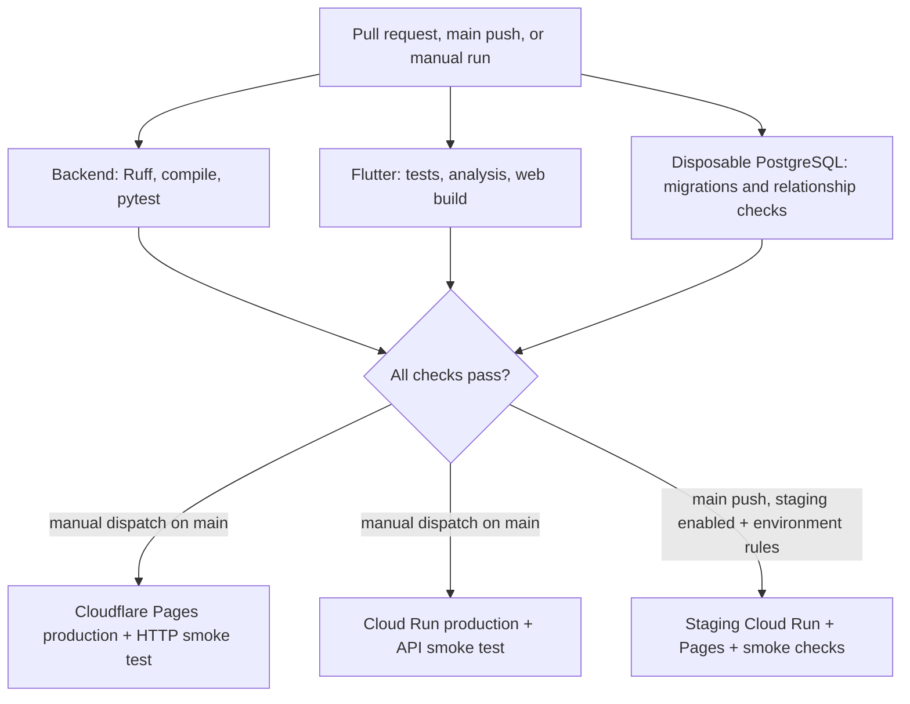

# CI/CD Pipeline

Lagaw uses one GitHub Actions workflow for pull request checks and deployments. Every deployment waits for the backend, frontend, and disposable PostgreSQL checks for the same commit.

## Workflow



## Pull requests and deployment gates

The `Lagaw CI` workflow runs on every pull request, push to `main`, and manual dispatch. Its PR checks are:

- `Backend - Python`: Ruff, Python compilation, and `python -m pytest -v`. Pytest discovers the current `unittest.TestCase` suite and future pytest tests. The current 69-test suite includes Trip HTTP CRUD checks using a mocked Supabase Data API.
- `Database - PostgreSQL migrations and smoke tests`: migrations and SQLAlchemy relationship checks against a disposable PostgreSQL service. The CI credentials are test-only.
- `Frontend - Flutter`: Flutter tests, analysis, and a web build.

Both production deployment jobs depend on all three checks, so a failed check prevents either deploy. Production API and Pages deployments run only after manually dispatching the workflow on `main`; each deploys the current `main` commit and performs its smoke check. Main pushes do not deploy production. Google Cloud authentication uses Workload Identity Federation restricted to `main`.

Pull requests run checks only; they do not publish Pages previews or production deployments. Main pushes automatically deploy staging for relevant backend, frontend, or deployment workflow changes after all three checks and the current `staging` environment protection rules. The staging web app is built separately against the staging Cloud Run URL with its own demo token and deployed to the Cloudflare Pages `staging` branch. Its read-only API smoke check covers locations, Trip authentication/ownership, and staging CORS; the Pages check verifies an HTTP response. Manual dispatch on `main` is reserved for production deployment. The Cloud Run production smoke check requests `/locations?limit=1` and requires at least one returned location.

Main branch protection requires one approving review and the three CI checks above, with stale approvals dismissed and strict up-to-date checks enabled. Force pushes and branch deletion are disabled. Deployment jobs are not required checks: staging follows qualifying pushes to `main` and production runs only after manual dispatch.

## Environment boundaries

Production Cloud Run reads `SUPABASE_URL` and `SUPABASE_SERVICE_ROLE_KEY` from Google Secret Manager. GitHub Actions stores only non-secret GCP identifiers as repository variables; its Cloudflare deploy credentials are repository Actions secrets.

Staging uses the existing development Supabase project and separate Cloud Run service credentials, synthetic demo profile, and Trip demo token. The workflow pins staging Secret Manager versions and a separate runtime service account can access only the staging secrets. The matching demo token is a GitHub `staging` environment secret, distinct from the production token. A separate Workload Identity provider is restricted to this repository's `main` branch and the GitHub `staging` environment; production identity configuration is unchanged. Automatic staging deployments are enabled; as checked October 25, the environment restricts deployments to protected branches without a required-reviewer rule. See [the staging runbook](docs/staging.md) for service boundaries and remaining verification.

The API tests use mocked HTTP transports and do not verify writes through a live Supabase Data API. The disposable PostgreSQL job verifies migrations and SQLAlchemy relationships separately. See [issue #29](https://github.com/relax-mode/lagaw/issues/29) for the remaining database-backed API test acceptance.

## Rollback

For Cloud Run, identify a known-good revision and route all traffic to it:

```sh
gcloud run revisions list --service lagaw-api --project relax-mode-lagaw --region asia-southeast1
gcloud run services update-traffic lagaw-api --project relax-mode-lagaw --region asia-southeast1 --to-revisions <known-good-revision>=100
```

For Cloudflare Pages, use the Cloudflare dashboard to promote a known-good deployment. Keep the failed deployment and commit IDs with the incident notes; do not delete deployment history.

## Metrics

The pipeline optimization measurements, run links, and before/after durations are recorded in [the pipeline metrics log](docs/pipeline-metrics.md).
