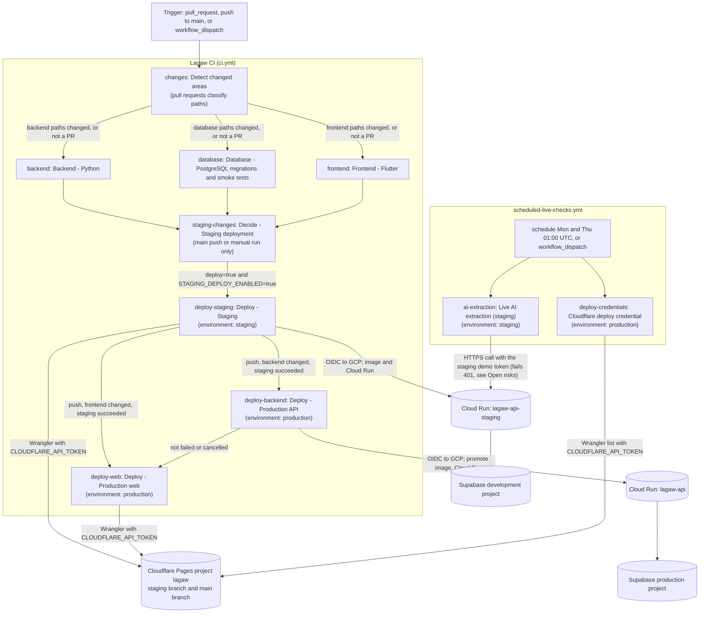

# CI/CD Pipeline

Lagaw uses two GitHub Actions workflows:

- `Lagaw CI` (`.github/workflows/ci.yml`) checks every pull request and carries every qualifying merge to `main` through staging into production with no manual steps.
- `Scheduled live checks` (`.github/workflows/scheduled-live-checks.yml`) runs the checks that must not run on every pull request. Its live AI check is currently failing; see [Open risks](#open-risks).

## Architecture

The job IDs in the diagram are the `jobs:` keys in each workflow file. The text after the colon is the job's display name. The diagram describes the workflow files on `main`; it does not show intended future behavior.



The scheduled workflow has no `needs:` link to `Lagaw CI`, so a failure there cannot block a merge or a deploy.

## Pull request checks

The `Lagaw CI` workflow runs on every pull request, every push to `main`, and every manual dispatch. It starts with `Detect changed areas`, which classifies the changed paths.

- On pull requests, each check runs only when its area changed. A check skipped this way still satisfies its required status check, and if classification itself fails, every check runs.
- Pushes and manual runs always run every check.
- Any change to `.github/workflows/ci.yml` runs all checks.

| Check | Runs on a PR when these change | What it does | Why it exists |
|---|---|---|---|
| `Backend - Python` | `backend/**`, `scripts/smoke_deployed.py`, `scripts/ai_live_smoke.py`, the committed AI evaluation baseline | Ruff (pinned, with inline PR annotations), `compileall`, `pytest -m "not db"`, then the offline AI evaluation (`evaluate_week3.py`) compared with the committed baseline (`compare_evaluation.py`). The comparison table goes to the job summary and the report is uploaded as the `ai-evaluation` artifact. | Fast correctness feedback, and a quality gate on every prompt or AI-logic change. Any extraction case, field check or recommendation metric that falls below the baseline fails the check. |
| `Database - PostgreSQL migrations and smoke tests` | `backend/**`, `supabase/**`, `scripts/check_database.py` | Disposable PostgreSQL 17: migrations and schema smoke, SQLAlchemy relationship checks, the itinerary association API against a disposable PostgREST, and `pytest -m db` database-backed API tests | Proves schema and persistence behavior against a database no other environment shares. Credentials are test-only. |
| `Frontend - Flutter` | `frontend/**`, `package.json`, `package-lock.json` | `flutter analyze` (cheap, first), `flutter test`, compile-only release web build | Catches Dart errors and UI regressions and proves the bundle builds. The job has no secrets; deploy jobs build their own bundles. |

### AI checks without the paid provider

- The backend tests and the evaluation run with a dummy `DEEPSEEK_API_KEY`, and with `HTTPS_PROXY`/`HTTP_PROXY` pointed at an unreachable port.
- HTTPX honours those proxies only for real transports, so the injected `MockTransport` stubs still answer while any accidental real provider request fails fast. CI therefore never needs a provider key and cannot spend provider quota.
- The tests check the schema and validity of outputs, not exact wording.
- No model training runs in CI. The hybrid recommender falls back to the deterministic content baseline when its JSON artifact is missing or invalid; `test_hybrid_recommendations.py` covers this. A production artifact must be a reviewed, committed file produced by `python -m app.recommendations.evaluate_hybrid --artifact`.
- To refresh the committed evaluation baseline after an intentional prompt or fixture change, run `python evaluate_week3.py --output ../docs/evidence/week3-evaluation.json` and review the diff in the PR. CI never rewrites it.

### Timeouts and concurrency

- Every job has a `timeout-minutes` limit.
- A new commit cancels an outdated PR run.
- Main and manual runs each get their own concurrency group, so a deploy waiting in one run cannot queue or cancel checks for later commits (see [INC-2](docs/incident-log.md#inc-2-main-runs-blocked-behind-a-staging-approval)).
- Each deploy job serializes through its own concurrency group.

## Continuous deployment

Every push to `main` that changes the application deploys automatically, when the repository variable `STAGING_DEPLOY_ENABLED` is `true`. `Decide - Staging deployment` diffs the push and flags backend and frontend changes; changes to `ci.yml` flag both. Docs-only and test-only merges deploy nothing: the gate ignores `backend/test_*.py`, `backend/smoke_test.*` and `frontend/test/*`.

1. **`Deploy - Staging`** (`deploy-staging`, GitHub `staging` environment) runs after the three checks and the decision job pass.
   - Builds and pushes the image `api:staging-<sha>` and deploys Cloud Run `lagaw-api-staging`, when backend changed.
   - Runs `scripts/smoke_deployed.py staging`: locations, Trip 401/200 and ownership, the extraction route (a blank prompt must return 422 before any provider call), and exact staging CORS. The check signs in with the smoke account; it creates no trips or interaction events, but the first sign-in can create the smoke profile.
   - Builds Flutter against the staging API and deploys the Pages `staging` branch, when frontend changed, then runs an HTTP check.
2. **`Deploy - Production API`** (`deploy-backend`, GitHub `production` environment) runs after a push when backend changed and `Deploy - Staging` succeeded.
   - Tags the image staging just tested as `api:<sha>`, so production runs exactly what staging verified.
   - Deploys Cloud Run `lagaw-api` and runs `scripts/smoke_deployed.py production`.
3. **`Deploy - Production web`** (`deploy-web`, `production` environment) runs after a push when frontend changed and `Deploy - Staging` succeeded. It does not wait for the production API job to succeed; it only skips if that job failed or was cancelled.
   - Builds Flutter with the production API URL and the production demo token (see [Open risks](#open-risks)).
   - Deploys Pages `main` and checks both the deployment URL and `https://lagaw.pages.dev`.

If a check, the staging deploy or a staging smoke test fails on a push, the later jobs of that run do not run, and production keeps serving the previous version. A provider outage cannot block unrelated deploys, because no deploy check calls the provider.

A **manual run** of the workflow on `main` (`gh workflow run ci.yml --ref main`) is for recovery and redeploys. It runs every check, then `deploy-staging`, `deploy-backend` (builds and pushes the image from the current commit) and `deploy-web`. Verified against run [40816925527](https://github.com/relax-mode/lagaw/actions/runs/40816925527) (Oct 29), where all three deploy jobs succeeded.

- The production jobs of a manual run do not require `deploy-staging` to succeed (`ci.yml`, the `if:` conditions of `deploy-backend` and `deploy-web`). A manual run can therefore redeploy production even if its staging job failed or was skipped.
- The comment above `deploy-backend` in `ci.yml` says a manual run redeploys production only. The job conditions show that staging also deploys. Workflow changes are out of scope for this document; the comment should be corrected in a workflow PR.
- Pull requests never deploy.

Main branch protection requires one approving review and the three CI checks above (`Backend - Python`, `Database - PostgreSQL migrations and smoke tests`, `Frontend - Flutter`), with stale approvals dismissed and strict up-to-date checks enabled. The rules also apply to administrators. Force pushes and branch deletion are disabled. Deployment jobs are not required checks. These settings were read from the GitHub API on Oct 30, 2026.

## Scheduled live checks

`Scheduled live checks` runs on Mondays and Thursdays at 09:00 Asia/Manila (cron `0 1 * * 1,4` UTC), and on demand with `gh workflow run scheduled-live-checks.yml`.

- **Live AI extraction** (`ai-extraction`, `staging` environment). `scripts/ai_live_smoke.py` sends one real extraction to deployed staging and requires a schema-valid draft. This exercises the Secret Manager key, the provider and the backend validation end to end, for one extraction call per run. The provider key never enters GitHub.
  - **Current status: failing.** Run [40831834404](https://github.com/relax-mode/lagaw/actions/runs/40831834404) (Oct 29) failed with HTTP 401 because the script still sends the retired staging demo token. See [INC-4](docs/incident-log.md#inc-4-scheduled-live-ai-check-returns-http-401). The fix is in review (PR #100). No passing run is recorded yet.
- **Cloudflare deploy credential** (`deploy-credentials`, `production` environment). Wrangler lists the `lagaw` deployments with the CI token, so an expired or revoked token fails here before a deploy needs it. It passed in run 40831834404 on Oct 29 (see [INC-1](docs/incident-log.md#inc-1-staging-cloudflare-credential-rejected)).

A failure never blocks merges or deploys, because no deploy job depends on this workflow.

## Environments and secrets

This section lists names only. No values are recorded here. The names were checked against the repository and environment secret and variable lists on Oct 30, 2026, and against the workflow files on `main`.

| | Pull requests | Staging | Production |
|---|---|---|---|
| GitHub environment | none; no deploy secrets | `staging`: protected branches only, no required reviewers | `production`: protected branches only, no required reviewers |
| Database | disposable PostgreSQL 17 service | Supabase development project `vnpkyvtbupnquvirzlzp` | Supabase production project `zjnuqqtbapbpudsjbpif` |
| Cloud Run service | none | `lagaw-api-staging`; runtime service account `lagaw-api-staging-runtime` | `lagaw-api`; runtime service account from the `GCP_RUNTIME_SERVICE_ACCOUNT` variable |
| Web (Cloudflare Pages `lagaw`) | none | branch `staging`, `https://staging.lagaw.pages.dev` | branch `main`, `https://lagaw.pages.dev` |
| Backend auth | none | `TRIP_AUTH_MODE=supabase` | `TRIP_AUTH_MODE=supabase` |
| DeepSeek settings | dummy key, network blocked | `DEEPSEEK_MODEL=deepseek-flash`, `DEEPSEEK_TIMEOUT_MS=20000` | same |

**Cloud Run secrets read from Secret Manager** (names and pinned versions as written in `ci.yml`; values are never printed):

| Cloud Run env var | Staging source | Production source |
|---|---|---|
| `SUPABASE_URL` | `STAGING_SUPABASE_URL:2` | `SUPABASE_URL:1` |
| `SUPABASE_SERVICE_ROLE_KEY` | `STAGING_SUPABASE_SERVICE_ROLE_KEY:2` | `SUPABASE_SERVICE_ROLE_KEY:1` |
| `DEEPSEEK_API_KEY` | `STAGING_DEEPSEEK_API_KEY:1` | `DEEPSEEK_API_KEY:1` |
| Collaborative model file (optional) | from the `MODEL_ARTIFACT_SECRET` variable | from the same variable name |

**GitHub names used by the workflows:**

| Name | Kind | Used by | Notes |
|---|---|---|---|
| `STAGING_DEPLOY_ENABLED` | repository variable | `deploy-staging` gate | Must be `true` for any staging deploy |
| `CLOUDFLARE_API_TOKEN`, `CLOUDFLARE_ACCOUNT_ID` | repository secrets | `deploy-staging`, `deploy-web`, `deploy-credentials` | Still repository-level, shared by staging and production; no environment copy exists |
| `TRIP_DEMO_TOKEN` | production environment secret, plus a repository secret of the same name | `deploy-web` web build | The repository copy is unused by any job that runs in an environment. Open risk. |
| `STAGING_TRIP_DEMO_TOKEN` | staging environment secret | `deploy-staging` gate and web build; `ai-extraction` | Open risk. Not passed to the backend. |
| `STAGING_TRIP_DEMO_USER_ID` | staging environment variable | `deploy-staging` gate only | Not read by the backend |
| `TRIP_DEMO_USER_ID` | production environment variable | not referenced by any workflow | Unused by the workflow |
| `SMOKE_AUTH_EMAIL`, `SMOKE_AUTH_PASSWORD` | staging and production environment secrets | smoke tests (sign-in) | |
| `SMOKE_PROFILE_ID`, `SMOKE_SUPABASE_KEY` | staging and production environment variables | smoke tests; `SMOKE_SUPABASE_KEY` is also the public anon key passed to the web builds | The name is historical |
| `GCP_PROJECT_ID`, `GCP_REGION`, `GCP_WORKLOAD_IDENTITY_PROVIDER`, `GCP_DEPLOYER_SERVICE_ACCOUNT`, `GCP_RUNTIME_SERVICE_ACCOUNT`, `CORS_ALLOWED_ORIGINS`, `API_BASE_URL` | repository variables | production jobs | |
| `STAGING_GCP_WORKLOAD_IDENTITY_PROVIDER`, `STAGING_GCP_DEPLOYER_SERVICE_ACCOUNT`, `STAGING_GCP_RUNTIME_SERVICE_ACCOUNT`, `STAGING_CORS_ALLOWED_ORIGINS` | repository variables | staging jobs | |
| `MODEL_ARTIFACT_SECRET`, `MODEL_FILE_SHA256` | staging environment variables | model delivery in `deploy-staging` and `deploy-backend` | Not set in the production environment or the repository. Production therefore resolves to model delivery disabled (`scripts/resolve_model_delivery.py`). |

**OIDC to Google Cloud.** The two jobs that deploy to Cloud Run (`deploy-staging` and `deploy-backend`) declare `permissions: id-token: write`. They exchange a GitHub OIDC token through `google-github-actions/auth@v2` for a short-lived credential of the environment's deployer service account, using the Workload Identity provider named in the matching variable. No long-lived Google Cloud key is stored in GitHub. `deploy-web` and the scheduled checks do not use OIDC. The trust conditions on the Workload Identity provider (repository, `refs/heads/main`, and the `staging` environment) live in Google Cloud, not in this repository, and were not re-checked here; `docs/staging.md` records them.

**Cloudflare Pages.** Web deploys run `wrangler pages deploy` for project `lagaw`, with `CLOUDFLARE_API_TOKEN` and `CLOUDFLARE_ACCOUNT_ID`. Staging deploys to branch `staging`; production deploys to branch `main`.

**Supabase.** The staging API uses the development project; the production API uses the production project. Each web build takes its Supabase URL from `ci.yml` and its anon key from the `SMOKE_SUPABASE_KEY` variable. The app refuses secret (`sb_secret_`) keys at startup (`frontend/lib/main.dart`, `isPublicSupabaseKey`).

**Notes:**

- Secret versions are pinned in `ci.yml`. A Cloud Run rollback restores the secret versions that the target revision used, and rotating a credential means adding a version and updating the pin through a reviewed PR.
- The DeepSeek key is read only by the backend; it never appears in GitHub, the Flutter build or logs.
- Per-service IAM bindings (which runtime account can read which secret) are not in this repository; `docs/staging.md` describes them and they were not re-checked here.

## Open risks

### Trip demo token is still compiled into the public web bundles

- **Still true.** `ci.yml` passes `secrets.STAGING_TRIP_DEMO_TOKEN` into the staging web build (`--dart-define=TRIP_DEMO_TOKEN`, line 515) and `secrets.TRIP_DEMO_TOKEN` into the production web build (line 745). Anyone who loads the site can read the value from the bundle.
- **No longer true.** The backend does not receive the token. `deploy-staging` and `deploy-backend` pass no `TRIP_DEMO_TOKEN` to Cloud Run (`ci.yml`, the `secrets:` blocks) and set `TRIP_AUTH_MODE=supabase`. In that mode `backend/app/auth.py` never checks the demo token; the demo path is only taken with `TRIP_AUTH_MODE=demo` on the development project or loopback, and `backend/test_auth.py` checks that demo values do not enable access by default. So the token does not authenticate against the hosted API.
- **Frontend use.** The app uses the compiled token only when `AuthSession.current` is null (`frontend/lib/auth/api_credentials.dart`), which happens when Supabase is not configured or fails to start (`frontend/lib/main.dart`). Deployed builds configure Supabase.
- **Still in use.** The scheduled live AI check sends `STAGING_TRIP_DEMO_TOKEN` as a bearer token (`scheduled-live-checks.yml`, line 34) and fails with HTTP 401 (see [INC-4](docs/incident-log.md#inc-4-scheduled-live-ai-check-returns-http-401)).
- **Still required by the gates.** `deploy-staging` fails if `STAGING_TRIP_DEMO_TOKEN` or `STAGING_TRIP_DEMO_USER_ID` is missing (`ci.yml`, configuration check). `deploy-web` fails if `TRIP_DEMO_TOKEN` is missing.
- **Recorded legacy settings.** The Oct 29 sprint-log entry records that the deployed Cloud Run services still carried legacy `TRIP_DEMO_USER_ID` and `TRIP_DEMO_TOKEN` settings from before #79, unused in `supabase` mode. The workflow's `overwrite` secrets strategy is meant to remove them on the next deploy. No live check of the current Cloud Run configuration is recorded here.
- **Remediation (not done).** Remove the `--dart-define` of the token and its gates from `ci.yml`, retire the GitHub secrets, and delete the Secret Manager entries. The Flutter code still reads the token, so the app-side change must come first. This is a workflow and app change, not part of this documentation update.
- **Owner:** CyGray (DevOps). Status: open.

### Scheduled AI extraction check failing

Run 40831834404 failed with HTTP 401 on Oct 29. The fix is in review (PR #100); a manual run on that branch was rejected by environment protection and did not test the fix. Status: open until a passing run is recorded. See [INC-4](docs/incident-log.md#inc-4-scheduled-live-ai-check-returns-http-401).

### One Cloudflare token for both environments

`CLOUDFLARE_API_TOKEN` and `CLOUDFLARE_ACCOUNT_ID` are repository secrets used by both staging and production. A single expiry blocks both (see [INC-1](docs/incident-log.md#inc-1-staging-cloudflare-credential-rejected)). Separating them is tracked in [CI/CD best practices](docs/cicd-best-practices.md). Status: open.

## AI failure drill

To show the manual fallback without touching live traffic, deploy a zero-traffic tagged staging revision with an invalid provider timeout, call it, then remove the tag:

```sh
IMG=$(gcloud run services describe lagaw-api-staging --project relax-mode-lagaw --region asia-southeast1 --format='value(spec.template.spec.containers[0].image)')
gcloud run deploy lagaw-api-staging --project relax-mode-lagaw --region asia-southeast1 --image "$IMG" --no-traffic --tag aifail --update-env-vars DEEPSEEK_TIMEOUT_MS=1
# POST https://aifail---lagaw-api-staging-i5kvldluga-as.a.run.app/api/v1/preferences/extract
# -> 503 {"detail": {"code": "extraction_unavailable", "manual_fallback": true, ...}}
gcloud run services update-traffic lagaw-api-staging --project relax-mode-lagaw --region asia-southeast1 --remove-tags aifail
gcloud run services update lagaw-api-staging --project relax-mode-lagaw --region asia-southeast1 --update-env-vars DEEPSEEK_TIMEOUT_MS=20000
gcloud run services update-traffic lagaw-api-staging --project relax-mode-lagaw --region asia-southeast1 --to-latest
```

The last two commands restore the service template and route traffic back to the latest revision, so the next deploy does not inherit the drill setting. This drill has not been run as a recorded exercise; this section documents the commands only.

## Rollback

The full staging and production rollback runbook and its helper script are in review in a separate pull request and are not on `main` yet. The commands below are the rollback path documented on `main`.

**Staging rollback drill: not performed.** No rollback drill has been executed on staging or production. It is pending explicit authorization to run it on staging (tracked in issue #120).

For Cloud Run, identify a known-good revision and route all traffic to it:

```sh
gcloud run revisions list --service lagaw-api --project relax-mode-lagaw --region asia-southeast1
gcloud run services update-traffic lagaw-api --project relax-mode-lagaw --region asia-southeast1 --to-revisions <known-good-revision>=100
```

Pinned traffic stays on that revision until it is moved back. After the fix merges, its promotion deploys a new revision; run `gcloud run services update-traffic lagaw-api ... --to-latest` to return to automatic routing.

The staging API uses the same pattern with `lagaw-api-staging` (see [`docs/staging.md`](docs/staging.md#rollback)).

For Cloudflare Pages, use the Cloudflare dashboard to promote a known-good deployment. Keep the failed deployment and commit IDs with the incident notes; do not delete deployment history.

## Metrics and incidents

- The weekly metrics, optimization measurements, run links and before/after durations are recorded in [the pipeline metrics log](docs/pipeline-metrics.md).
- Regenerate a week's figures with `python scripts/pipeline_metrics.py --since <YYYY-MM-DD> --until <YYYY-MM-DD> --jobs`.
- Broken builds and failed deploys on `main` or deployed environments are recorded, with postmortems, in [the incident log](docs/incident-log.md).
