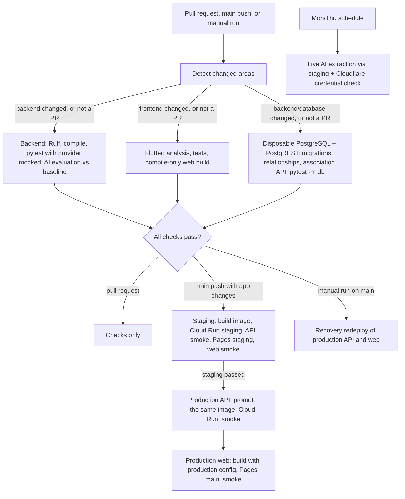

# CI/CD Pipeline

Lagaw uses two GitHub Actions workflows:

- `Lagaw CI` (`.github/workflows/ci.yml`) checks every pull request and carries every qualifying merge to `main` through staging into production with no manual steps.
- `Scheduled live checks` (`.github/workflows/scheduled-live-checks.yml`) runs the checks that must not run on every pull request.

## Workflow



## Pull request checks

The `Lagaw CI` workflow runs on every pull request, every push to `main`, and every manual dispatch. It starts with `Detect changed areas`, which classifies the changed paths.

- On pull requests, each check runs only when its area changed. A check skipped this way still satisfies its required status check, and if classification itself fails, every check runs.
- Pushes and manual runs always run every check.
- Any change to `.github/workflows/ci.yml` runs all checks.

| Check | Runs on a PR when these change | What it does | Why it exists |
|---|---|---|---|
| `Backend - Python` | `backend/**`, `scripts/smoke_deployed.py`, `scripts/ai_live_smoke.py`, the committed AI evaluation baseline | Ruff (pinned, with inline PR annotations), `compileall`, `pytest -m "not db"`, then the offline AI evaluation (`evaluate_week3.py`) compared with the committed baseline (`compare_evaluation.py`). The comparison table goes to the job summary and the report is uploaded as the `ai-evaluation` artifact. | Fast correctness feedback, and a quality gate on every prompt or AI-logic change. Any extraction case, field check or recommendation metric that falls below the baseline fails the check. |
| `Database - PostgreSQL migrations and smoke tests` | `backend/**`, `supabase/**`, `scripts/check_database.py` | Disposable PostgreSQL 17: migrations and schema smoke, SQLAlchemy relationship checks, the itinerary association API against a disposable PostgREST, and `pytest -m db` database-backed API tests | Proves schema and persistence behavior against a database no other environment shares. Credentials are test-only. |
| `Frontend - Flutter` | `frontend/**`, `package.json`, `package-lock.json` | `flutter analyze` (cheap, first), `flutter test`, compile-only release web build | Catches Dart errors and UI regressions and proves the bundle builds. The job has no secrets; deploy jobs build their own bundles. |

### AI checks without the paid provider

- The backend tests and the evaluation run with a dummy `DEEPSEEK_API_KEY`, and with `HTTPS_PROXY`/`HTTP_PROXY` pointed at an unreachable port.
- HTTPX honours those proxies only for real transports, so the injected `MockTransport` stubs still answer while any accidental real provider request fails fast. CI therefore never needs a provider key and cannot spend provider quota.
- The tests check the schema and validity of outputs, not exact wording.
- No model training runs in CI. The hybrid recommender falls back to the deterministic content baseline when its JSON artifact is missing or invalid; `test_hybrid_recommendations.py` covers this. A production artifact must be a reviewed, committed file produced by `python -m app.recommendations.evaluate_hybrid --artifact`.
- To refresh the committed evaluation baseline after an intentional prompt or fixture change, run `python evaluate_week3.py --output ../docs/evidence/week3-evaluation.json` and review the diff in the PR. CI never rewrites it.

### Timeouts and concurrency

- Every job has a `timeout-minutes` limit.
- A new commit cancels an outdated PR run.
- Main and manual runs each get their own concurrency group, so a deploy waiting in one run cannot queue or cancel checks for later commits (see [INC-2](docs/incident-log.md#inc-2-main-runs-blocked-behind-a-staging-approval)).
- Each deploy job serializes through its own concurrency group.

## Continuous deployment

Every push to `main` that changes the application deploys automatically. `Decide - Staging deployment` diffs the push and flags backend and frontend changes; changes to `ci.yml` flag both. Docs-only and test-only merges deploy nothing.

1. **`Deploy - Staging`** (GitHub `staging` environment) runs after all three checks pass.
   - Builds and pushes the image `api:staging-<sha>` and deploys Cloud Run `lagaw-api-staging`.
   - Runs `scripts/smoke_deployed.py staging`: locations, Trip 401/200 and ownership, the extraction route (a blank prompt must return 422 before any provider call), and exact staging CORS.
   - Builds Flutter against the staging API and deploys the Pages `staging` branch, then runs an HTTP check.
2. **`Deploy - Production API`** (GitHub `production` environment) runs only after staging passes.
   - Tags the image staging just tested as `api:<sha>`, so production runs exactly what staging verified.
   - Deploys Cloud Run `lagaw-api` and runs `scripts/smoke_deployed.py production`.
3. **`Deploy - Production web`** (`production` environment) runs after the production API succeeds or was not needed.
   - Builds Flutter with the production API URL and the production demo token.
   - Deploys Pages `main` and checks both the deployment URL and `https://lagaw.pages.dev`.

If a check, the staging deploy or a smoke test fails, nothing later runs and production keeps serving the previous version. A provider outage cannot block unrelated deploys, because no deploy check calls the provider.

A **manual run** of the workflow on `main` (`gh workflow run ci.yml --ref main`) is for recovery only. It runs every check and then redeploys both production jobs from the current `main` commit, building the image directly. Pull requests never deploy.

Main branch protection requires one approving review and the three CI checks above, with stale approvals dismissed and strict up-to-date checks enabled. The rules also apply to administrators. Force pushes and branch deletion are disabled. Deployment jobs are not required checks.

## Scheduled live checks

`Scheduled live checks` runs on Mondays and Thursdays at 09:00 Asia/Manila, and on demand with `gh workflow run scheduled-live-checks.yml`.

- **Live AI extraction** (`staging` environment). `scripts/ai_live_smoke.py` sends one real extraction to deployed staging and requires a schema-valid draft. This exercises the Secret Manager key, the provider and the backend validation end to end, for one extraction call per run. The provider key never enters GitHub.
- **Cloudflare deploy credential.** Wrangler lists the `lagaw` deployments with the CI token, so an expired or revoked token fails here before a deploy needs it (see [INC-1](docs/incident-log.md#inc-1-staging-cloudflare-credential-rejected)).

A failure notifies by email and never blocks merges or deploys.

## Environment boundaries

| | CI (pull requests) | Staging | Production |
|---|---|---|---|
| GitHub environment | none; no deploy secrets | `staging` (protected branches) | `production` (protected branches, no reviewer, so deploys stay automatic) |
| Database | disposable PostgreSQL service | development Supabase project | production Supabase project |
| Cloud Run service / runtime identity | none | `lagaw-api-staging` / `lagaw-api-staging-runtime` | `lagaw-api` / `lagaw-api` |
| Secret Manager (pinned versions) | none | `STAGING_SUPABASE_URL:2`, `STAGING_SUPABASE_SERVICE_ROLE_KEY:2`, `STAGING_TRIP_DEMO_TOKEN:1`, `STAGING_DEEPSEEK_API_KEY:1` | `SUPABASE_URL:1`, `SUPABASE_SERVICE_ROLE_KEY:1`, `TRIP_DEMO_TOKEN:1`, `DEEPSEEK_API_KEY:1` |
| GitHub secrets / variables | none | `STAGING_TRIP_DEMO_TOKEN` / `STAGING_TRIP_DEMO_USER_ID` | `TRIP_DEMO_TOKEN` / `TRIP_DEMO_USER_ID` |
| DeepSeek | dummy key, network blocked | `DEEPSEEK_MODEL=deepseek-flash`, `DEEPSEEK_TIMEOUT_MS=20000` | same settings |
| Workload Identity provider | none | `github-staging` (main + `staging` environment) | `github` (main) |

Additional notes:

- Each runtime service account can read only its own environment's secrets. The DeepSeek key is read only by the backend; it never appears in GitHub, the Flutter build or logs.
- The demo token compiled into each web bundle is public by design and scoped to a synthetic profile.
- Secret versions are pinned in the workflow. A Cloud Run rollback therefore also restores the secrets that revision used, and rotating a credential means adding a version and updating the pin through a reviewed PR.
- The Cloudflare token and account ID are still repository secrets shared by staging and production; separating them is a follow-up recorded in the sprint log.

## AI failure drill

To show the manual fallback without touching live traffic, deploy a zero-traffic tagged staging revision with an invalid provider timeout, call it, then remove the tag:

```sh
IMG=$(gcloud run services describe lagaw-api-staging --project relax-mode-lagaw --region asia-southeast1 --format='value(spec.template.spec.containers[0].image)')
gcloud run deploy lagaw-api-staging --project relax-mode-lagaw --region asia-southeast1 --image "$IMG" --no-traffic --tag aifail --update-env-vars DEEPSEEK_TIMEOUT_MS=1
# POST https://aifail---lagaw-api-staging-i5kvldluga-as.a.run.app/api/v1/preferences/extract
# -> 503 {"detail": {"code": "extraction_unavailable", "manual_fallback": true, ...}}
gcloud run services update-traffic lagaw-api-staging --project relax-mode-lagaw --region asia-southeast1 --remove-tags aifail
gcloud run services update lagaw-api-staging --project relax-mode-lagaw --region asia-southeast1 --update-env-vars DEEPSEEK_TIMEOUT_MS=20000
gcloud run services update-traffic lagaw-api-staging --project relax-mode-lagaw --region asia-southeast1 --to-latest
```

The last two commands restore the service template and route traffic back to the latest revision, so the next deploy does not inherit the drill setting.

## Rollback

For Cloud Run, identify a known-good revision and route all traffic to it:

```sh
gcloud run revisions list --service lagaw-api --project relax-mode-lagaw --region asia-southeast1
gcloud run services update-traffic lagaw-api --project relax-mode-lagaw --region asia-southeast1 --to-revisions <known-good-revision>=100
```

Pinned traffic stays on that revision until it is moved back. After the fix merges, its promotion deploys a new revision; run `gcloud run services update-traffic lagaw-api ... --to-latest` to return to automatic routing.

For Cloudflare Pages, use the Cloudflare dashboard to promote a known-good deployment. Keep the failed deployment and commit IDs with the incident notes; do not delete deployment history.

## Metrics and incidents

- The weekly metrics, optimization measurements, run links and before/after durations are recorded in [the pipeline metrics log](docs/pipeline-metrics.md).
- Regenerate a week's figures with `python scripts/pipeline_metrics.py --since <YYYY-MM-DD> --until <YYYY-MM-DD> --jobs`.
- Broken builds and failed deploys on `main` or deployed environments are recorded, with postmortems, in [the incident log](docs/incident-log.md).
