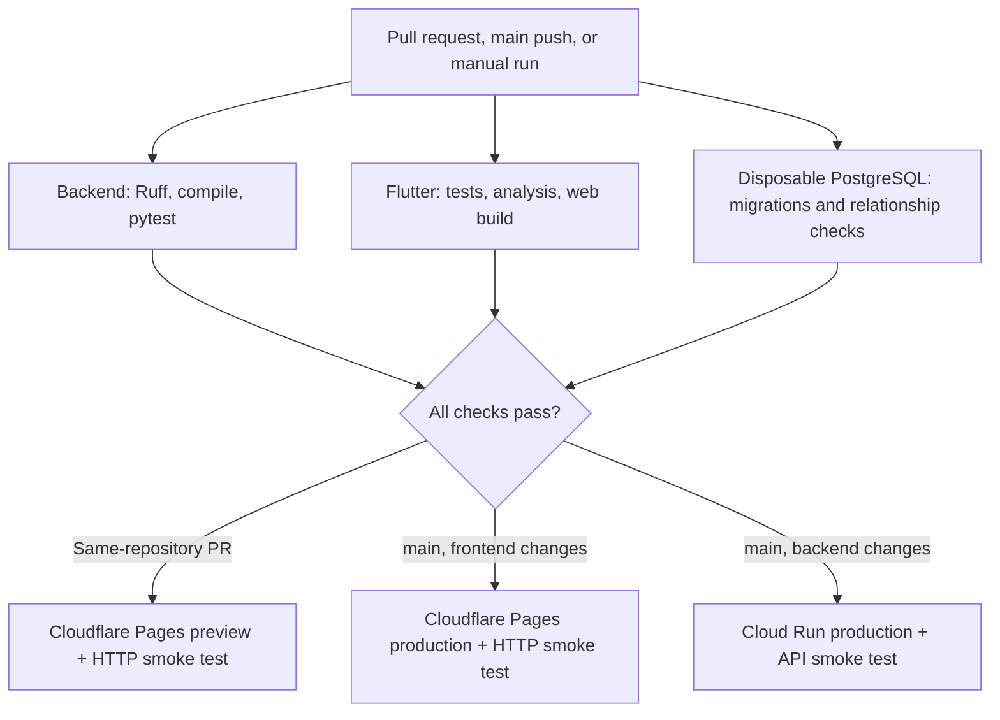

# CI/CD Pipeline

Lagaw uses one GitHub Actions workflow for pull request checks and deployments. Every deployment waits for the backend, frontend, and disposable PostgreSQL checks for the same commit.

## Workflow



## Pull requests and deployment gates

The `Lagaw CI` workflow runs on every pull request, push to `main`, and manual dispatch. Its PR checks are:

- `Backend - Python`: Ruff, Python compilation, and `python -m pytest -v`. Pytest discovers the current `unittest.TestCase` suite and future pytest tests. The current 69-test suite includes Trip HTTP CRUD checks using a mocked Supabase Data API.
- `Database - PostgreSQL migrations and smoke tests`: migrations and SQLAlchemy relationship checks against a disposable PostgreSQL service. The CI credentials are test-only.
- `Frontend - Flutter`: Flutter tests, analysis, and a web build.

Both deployment jobs depend on all three checks, so a failed check prevents the corresponding deploy. The backend deploy runs only for `main` pushes that change backend runtime files or the CI workflow; manual production deploys can be started by dispatching the workflow on `main`. Google Cloud authentication uses Workload Identity Federation restricted to `main`.

Same-repository pull requests publish a Cloudflare Pages preview after all checks pass. Fork pull requests run checks but do not receive deploy credentials. Production Pages deploys run after checks on `main`. Both Pages deployments use the web artifact built by the frontend job and perform an HTTP smoke check. The backend production deploy smoke check requests `/locations?limit=1` and requires at least one returned location.

Main branch protection will require one approving review and the three CI checks above. Deploy jobs are not required checks because they only run after a merge to `main`.

## Environment boundaries

Production Cloud Run reads `SUPABASE_URL` and `SUPABASE_SERVICE_ROLE_KEY` from Google Secret Manager. GitHub Actions stores only non-secret GCP identifiers as repository variables; its Cloudflare deploy credentials are repository Actions secrets.

**PR previews are not yet data-isolated.** The Flutter web build currently uses the repository-level `API_BASE_URL`, which points to the production backend. A preview therefore calls production until the staging environment in [issue #30](https://github.com/relax-mode/lagaw/issues/30) is configured. Do not treat a Pages preview as a staging acceptance check before that work is complete.

The API tests use mocked HTTP transports and do not verify writes through a live Supabase Data API. The disposable PostgreSQL job verifies migrations and SQLAlchemy relationships separately. See [issue #29](https://github.com/relax-mode/lagaw/issues/29) for the remaining database-backed API test acceptance.

## Rollback

For Cloud Run, identify a known-good revision and route all traffic to it:

```sh
gcloud run revisions list --service lagaw-api --project relax-mode-lagaw --region asia-southeast1
gcloud run services update-traffic lagaw-api --project relax-mode-lagaw --region asia-southeast1 --to-revisions <known-good-revision>=100
```

For Cloudflare Pages, use the Cloudflare dashboard to promote a known-good deployment. Keep the failed deployment and commit IDs with the incident notes; do not delete deployment history.

## Metrics

The pipeline optimization measurements, run links, and before/after durations are recorded in [the pipeline metrics log](docs/pipeline-metrics.md).
