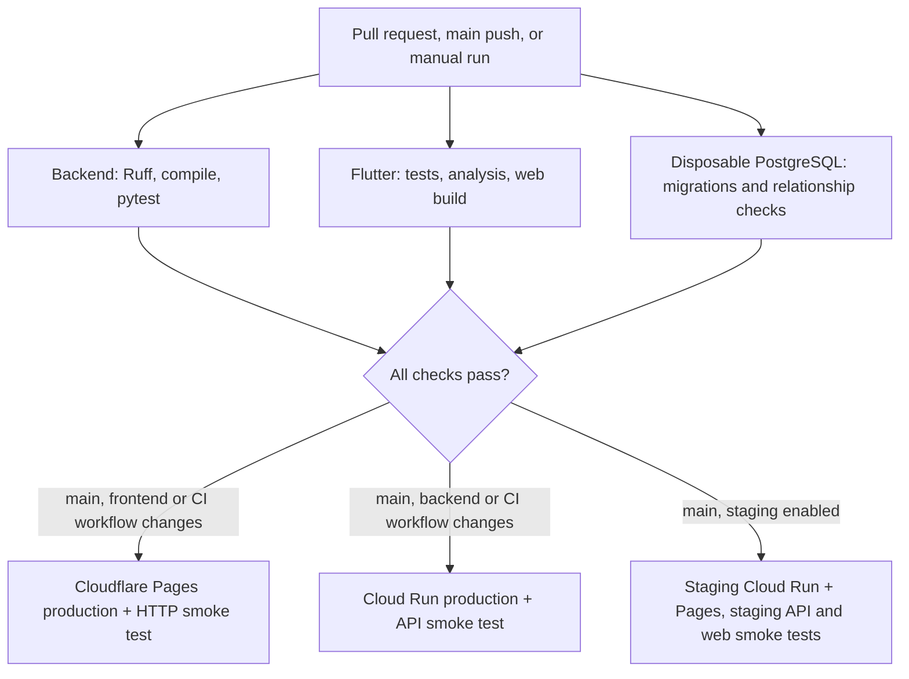

# CI/CD Pipeline

Lagaw uses one GitHub Actions workflow for pull request checks and deployments. Every deployment waits for the backend, frontend, and disposable PostgreSQL checks for the same commit.

## Workflow



## Pull requests and deployment gates

The `Lagaw CI` workflow runs on every pull request, push to `main`, and manual dispatch. Its PR checks are:

- `Backend - Python`: Ruff, Python compilation, and `python -m pytest -v`. Pytest discovers the current `unittest.TestCase` suite and future pytest tests. The current 69-test suite includes Trip HTTP CRUD checks using a mocked Supabase Data API.
- `Database - PostgreSQL migrations and smoke tests`: migrations and SQLAlchemy relationship checks against a disposable PostgreSQL service. The CI credentials are test-only.
- `Frontend - Flutter`: Flutter tests, analysis, and a web build.

Production deployments depend on all three checks, so a failed check prevents the corresponding deploy. The backend deploy runs only for `main` pushes that change backend runtime files or the CI workflow; manual production deploys can be started by dispatching the workflow on `main`. Google Cloud authentication uses Workload Identity Federation restricted to `main`.

Pull requests run checks only; they do not publish Pages previews. This prevents PR bundles from calling the production API. Production Pages deploys run after checks on `main` when frontend, package, or CI workflow files change. Production builds use the production API base URL and perform an HTTP smoke check. The backend production deploy smoke check requests `/locations?limit=1` and requires at least one returned location.

When enabled, the staging job also waits for all three checks and runs only for relevant changes on `main` or a manual dispatch on `main`. It builds a separate Flutter bundle against the staging Cloud Run URL, deploys it to the Cloudflare Pages `staging` branch, and checks both the API and deployed web response. See [the staging runbook](docs/staging.md) for the service boundaries, activation gate, and verification steps.

Main branch protection now requires one approving review and the three CI checks above, with stale approvals dismissed and strict up-to-date checks enabled. Force pushes and branch deletion are disabled. Deploy jobs are not required checks because they only run after a merge to `main`.

## Environment boundaries

Production Cloud Run reads `SUPABASE_URL` and `SUPABASE_SERVICE_ROLE_KEY` from Google Secret Manager. GitHub Actions stores only non-secret GCP identifiers as repository variables; its Cloudflare deploy credentials are repository Actions secrets.

Staging uses the existing development Supabase project and separate Cloud Run service credentials. The workflow pins staging Secret Manager versions and a separate runtime service account can access only the staging secrets. A separate Workload Identity provider is restricted to this repository's `main` branch and the GitHub `staging` environment; production identity configuration is unchanged. Automated staging deploys remain disabled until the `staging` GitHub environment has a required reviewer. Current provisioning and the remaining activation step are recorded in [the staging runbook](docs/staging.md).

The API tests use mocked HTTP transports and do not verify writes through a live Supabase Data API. The disposable PostgreSQL job verifies migrations and SQLAlchemy relationships separately. See [issue #29](https://github.com/relax-mode/lagaw/issues/29) for the remaining database-backed API test acceptance.

## Rollback

For Cloud Run, identify a known-good revision and route all traffic to it:

```sh
gcloud run revisions list --service lagaw-api --project relax-mode-lagaw --region asia-southeast1
gcloud run services update-traffic lagaw-api --project relax-mode-lagaw --region asia-southeast1 --to-revisions <known-good-revision>=100
```

For Cloudflare Pages, use the Cloudflare dashboard to promote a known-good deployment. Keep the failed deployment and commit IDs with the incident notes; do not delete deployment history.

## Metrics

The pipeline optimization measurements, run links, and before/after durations are recorded in [the pipeline metrics log](docs/pipeline-metrics.md).
