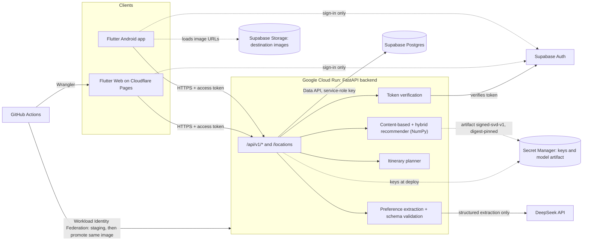

# Lagaw

**Swipe through Bacolod. Get a trip that fits you.**

**Roel and coding assistants working on #56: [START HERE — agreed backend APIs and complete frontend flow](ROEL_START_HERE.md).**

Lagaw (Hiligaynon for roaming around) is a swipe-based travel planner for Bacolod City, built as an Android app with a companion web build. It learns what you like, then turns it into a day-by-day itinerary that respects your budget, opening hours, and travel time. No more scrolling through generic "top 10" lists.

## How it works

1. **Swipe.** Right on places you like, left on ones you don't. Save favorites and rate the places you've visited.
2. **Say what you want.** Set a budget and pick tags, or just type it: *"a cheap, relaxing afternoon with coffee and photography spots."*
3. **Get a plan.** Lagaw ranks destinations for you and arranges them into an itinerary you can edit, save, or archive.

## Under the hood

**Hybrid recommender.** Matrix factorization finds taste patterns across users. Content-based filtering matches your preferences to each place's category, tags, cost, group fit, setting, visit length, and accessibility. The two scores are blended, and new users lean on tags and budget until their swipes give the model more to work with.

**Structured extraction.** DeepSeek-V4.1-Flash, accessed through the official DeepSeek API platform, turns free-text requests into structured preferences (budget level, tags, duration, pace). It only extracts. It never generates recommendations, and it is called from the backend only, never from the app.

**Validated output.** Nothing from the models reaches the frontend raw. The backend checks extracted values against a schema and approved tags, then filters recommendations for inactive, duplicate, or incompatible places and applies budget, group, accessibility, and distance limits. The itinerary planner then checks operating hours, travel time, and cost for conflicts.

The recommender is our own Python model and runs on our backend. If DeepSeek is unavailable, users fall back to the standard trip form.

## Tech stack

| Layer | Tools |
| --- | --- |
| Frontend | Flutter (Dart): Android app, plus a Flutter Web build from the same codebase |
| Backend | FastAPI, Python |
| Recommender | NumPy: content-based scoring plus a rank-3 SVD matrix-factorization model (`signed-svd-v1`) as the approved equivalent to LightFM; see [`docs/hybrid-recommender.md`](docs/hybrid-recommender.md) |
| Extraction | DeepSeek-V4.1-Flash via the official DeepSeek API (`httpx`) |
| Database | PostgreSQL on Supabase |
| Hosting | Android APK for testing, web build on Cloudflare Pages, backend on Google Cloud Run, Supabase for database and storage |
| DevOps | GitHub Actions CI/CD; Wrangler CLI for managing and deploying Cloudflare Pages, run locally and from CI/CD |

## Team

| Member | GitHub | Role | Owns |
| --- | --- | --- | --- |
| Kyle | [@CyGray](https://github.com/CyGray) | DevOps Engineer | CI/CD pipeline, environments and secrets, deployments, pipeline metrics and incidents ([`PIPELINE.md`](PIPELINE.md)) |
| Andrew | [@aranxshx](https://github.com/aranxshx) | Backend / API Engineer | FastAPI endpoints, validation, database access, backend and database tests |
| Roel | [@roellumauagjr](https://github.com/roellumauagjr) | Frontend Engineer | Flutter app, web build, wiring the UI to the API |
| Jayperson | [@s2302663-del](https://github.com/s2302663-del) | AI Engineer | Preference extraction, recommendation models, AI evaluation |

Roles follow the issue assignments. Record any role change, with its reason, in the [sprint log](docs/sprint-log.md).

## Live app

| What | URL |
| --- | --- |
| Production web | <https://lagaw.pages.dev> |
| Staging web | <https://staging.lagaw.pages.dev> |
| Production API base | <https://lagaw-api-663710289405.asia-southeast1.run.app> |
| API reference (interactive) | [`/docs`](https://lagaw-api-663710289405.asia-southeast1.run.app/docs) |
| OpenAPI spec | [`/openapi.json`](https://lagaw-api-663710289405.asia-southeast1.run.app/openapi.json) |
| Health and readiness | [`/health`](https://lagaw-api-663710289405.asia-southeast1.run.app/health), [`/ready`](https://lagaw-api-663710289405.asia-southeast1.run.app/ready) |

All of these returned HTTP 200 when checked on 27 November 2026. The API runs on Cloud Run with scale to zero, so the first request after idle time can be slow.

The Android app is built as a release APK for testing and installed on team test devices. There is no public download link. How the APK is built and checked is recorded in the [sprint log](docs/sprint-log.md) (#117) and the [release process](docs/release-process.md). Staging deploys from every qualifying merge to `main`, and production follows only after staging passes ([PIPELINE.md](PIPELINE.md#continuous-deployment)).

## Architecture



Reading the diagram:

- **Clients** use Supabase only to sign in and hold the session (`supabase_flutter`, used for `auth` in `frontend/lib/main.dart` and `frontend/lib/auth/`). Trips, locations, preferences, interactions and recommendations all go through the FastAPI backend. Destination photos are public Storage URLs that the backend returns in `image_url`.
- **Backend** checks each access token against Supabase Auth, then scopes every read and write to that user ([authentication contract](docs/authentication.md)). It reads the database through the Supabase Data API with a server-side key that never reaches the app.
- **Recommender and planner** run in-process in the backend. A fitted rank-3 SVD artifact (`signed-svd-v1`) is mounted from Secret Manager at startup and pinned by SHA-256. Without it, the backend serves content-only results ([hybrid recommender](docs/hybrid-recommender.md), [model serving](docs/collaborative-model-serving.md)).
- **DeepSeek** is called from the backend only, for structured preference extraction. The output is validated before it is returned ([preference extraction contract](docs/preference-extraction-api.md)).
- **Delivery.** GitHub Actions reaches Google Cloud through Workload Identity Federation, so no long-lived Google key is stored in GitHub. Staging deploys first, and production runs the same image that passed staging. Image storage is described in [docs/destination-image-storage.md](docs/destination-image-storage.md).

Key design decisions:

- **The model only extracts.** DeepSeek turns free text into a preference draft that the backend validates. Ranking and itinerary building are our own code ([pitch](docs/pitch.md)).
- **One door to the data.** The app never calls DeepSeek and never reads or writes app data in the database directly. This keeps validation, ownership checks and quotas in one place.
- **One image, two environments.** Production runs the image that staging already verified, instead of rebuilding it.
- **Free-tier hosting.** Cloud Run runs with `--min-instances=0` and `--max-instances=2`, which keeps cost near zero at the price of cold starts.
- **Shared staging instead of per-PR previews.** Preview builds would call the production API or need a backend per PR ([scope changes](docs/scope-changes.md)).

## Run locally

Prerequisites: Python 3.12, Flutter 3.47 (the version CI uses), Node 20+ for the Supabase CLI, and a Supabase project of your own for the database. Do not point a local run at the production project.

**1. Environment.** Copy `.env.example` to `.env` at the repository root and fill in your own values. The backend reads it. Flutter does not.

```sh
cp .env.example .env
```

**2. Database.** Apply the migrations in [`supabase/migrations`](supabase/migrations) to your Supabase project. The seed migration `20261014154651_seed_sample_locations.sql` adds the first ten Bacolod destinations. Details, the local Supabase stack and the smoke test are in [docs/database.md](docs/database.md) and [docs/locations-api.md](docs/locations-api.md).

```sh
npx supabase link --project-ref YOUR_TEST_PROJECT_REF
npx supabase db push
```

**3. Backend.**

```sh
python -m venv .venv
.venv/bin/python -m pip install -r backend/requirements-dev.txt   # Windows: .venv\Scripts\python.exe
.venv/bin/python -m uvicorn app.main:app --app-dir backend --reload
```

Open <http://127.0.0.1:8000/docs>. To let Flutter Web call it, set `CORS_ALLOWED_ORIGINS` as in [docs/cors.md](docs/cors.md). DeepSeek setup is in [docs/deepseek-setup.md](docs/deepseek-setup.md).

**4. Frontend.**

```sh
cd frontend
flutter pub get
flutter run -d chrome --web-port 3000 \
  --dart-define=API_BASE_URL=http://127.0.0.1:8000 \
  --dart-define=SUPABASE_URL=https://YOUR_PROJECT.supabase.co \
  --dart-define=SUPABASE_ANON_KEY=YOUR_PUBLISHABLE_KEY
```

The app reads these build-time values in `frontend/lib/config.dart`: `API_BASE_URL` (defaults to `http://127.0.0.1:8000`), `SUPABASE_URL`, `SUPABASE_ANON_KEY`, `AUTH_REDIRECT_URL` (optional) and `TRIP_DEMO_TOKEN` (legacy demo path). A release build refuses to run without the first three. Use only the public publishable key here, never a service-role key.

**5. Tests.** CI runs the same commands ([testing guide](docs/regression-tests.md)).

```sh
cd backend
python -m pytest -v -m "not db"        # offline, provider mocked
python evaluate_week3.py --check       # offline AI evaluation, see docs/week3-evaluation.md
cd ../frontend
flutter analyze && flutter test
```

Database-backed tests (`pytest -m db`) need a disposable PostgreSQL. See [docs/database.md](docs/database.md) and `python scripts/check_database.py --bootstrap-roles`.

**Optional: demo recommender data.** `backend/seed_demo_interactions.py` creates five clearly named demo accounts and seeds their swipes through the API, so the collaborative model has something to train on. It writes private files outside the repository and is described in [docs/collaborative-model-serving.md](docs/collaborative-model-serving.md). The hosted catalogue was later expanded from 10 to 30 places ([docs/location-expansion-2026-11-15.md](docs/location-expansion-2026-11-15.md)).

## Final deliverables

Where each item of the course checklist lives. "Not in repo" means the item is outside the repository.

| Item | Location | Note |
| --- | --- | --- |
| **Product** | | |
| Production URL | [Live app](#live-app) | v1.0.0 is a release candidate. No tag is published yet ([release process](docs/release-process.md)). |
| Source: frontend | [`frontend/`](frontend) | Flutter (Android and Web) |
| Source: backend | [`backend/`](backend) | FastAPI |
| Source: database migrations | [`supabase/migrations/`](supabase/migrations) | Tests in [`supabase/tests/`](supabase/tests) |
| `.env.example` | [`.env.example`](.env.example) | Names only, no values |
| Seed data or setup script | [Run locally](#run-locally) | Seed migration, [`backend/seed_demo_interactions.py`](backend/seed_demo_interactions.py), [`scripts/check_database.py`](scripts/check_database.py) |
| **Documentation** | | |
| README | This file | What it does, [team](#team), [tech stack](#tech-stack), [setup](#run-locally) |
| Architecture diagram | [Architecture](#architecture) | Pipeline view in [PIPELINE.md](PIPELINE.md#architecture) |
| Database schema | [docs/database.md](docs/database.md#tables-and-relationships) | ER diagram and field notes |
| API reference | [`/docs`](https://lagaw-api-663710289405.asia-southeast1.run.app/docs), [`/openapi.json`](https://lagaw-api-663710289405.asia-southeast1.run.app/openapi.json) | Endpoint guides are linked under [Configuration](#configuration), for example [trips](docs/trips-api.md) and [locations](docs/locations-api.md). No OpenAPI snapshot is committed. |
| AI feature write-up | [Extraction contract](docs/preference-extraction-api.md), [hybrid recommender](docs/hybrid-recommender.md), [content-based recommender](docs/content-based-recommender.md), [Week 3 evaluation](docs/week3-evaluation.md), [content-first evaluation](docs/content-first-evaluation.md), [failure coverage](docs/ai-failure-coverage.md) | Approach, prompts and tools, output processing, evaluation results and known limitations are spread across these documents. |
| Changelog | [CHANGELOG.md](CHANGELOG.md) | v1.0.0 (2026-11-27), with [release notes](docs/release-notes/v1.0.0.md) |
| **Process evidence** | | |
| Project board | GitHub Projects board (link to be added) | Issues and PRs are in the [repository](https://github.com/relax-mode/lagaw). |
| Sprint log | [docs/sprint-log.md](docs/sprint-log.md) | Sprint plans, activity notes, and the Sprint 3 and Sprint 4 retrospectives. Formal async standups were not recorded, and Sprint 1 and 2 retrospectives are pending. |
| Scope change log | [docs/scope-changes.md](docs/scope-changes.md) | |
| **DevOps** | | |
| Pipeline configuration | [`.github/workflows/ci.yml`](.github/workflows/ci.yml), [`scheduled-live-checks.yml`](.github/workflows/scheduled-live-checks.yml) | |
| PIPELINE.md and diagram | [PIPELINE.md](PIPELINE.md#architecture) | Mermaid diagram of the workflow jobs |
| Pipeline metrics log | [docs/pipeline-metrics.md](docs/pipeline-metrics.md) | |
| Optimization log | [docs/pipeline-metrics.md](docs/pipeline-metrics.md) | Before and after numbers are in the same file |
| Deploy and rollback runbook | [docs/rollback-runbook.md](docs/rollback-runbook.md) | Deploy flow in [PIPELINE.md](PIPELINE.md#continuous-deployment) |
| Incident log | [docs/incident-log.md](docs/incident-log.md) | INC-1 to INC-6 with postmortems |
| **Presentation** | | |
| Slide deck | Not in repo | Presented separately |
| AI provider failure simulation | [PIPELINE.md, AI failure drill](PIPELINE.md#ai-failure-drill) | Commands only. The doc says the drill has not been run as a recorded exercise. |

## Configuration

Copy `.env.example` to `.env` and fill in your own values, including a DeepSeek API key (`DEEPSEEK_API_KEY`). The `.env` file is gitignored and no secret should ever be hardcoded.

Full project pitch: [docs/pitch.md](docs/pitch.md)

Database schema, local migrations, and verification:
[docs/database.md](docs/database.md).

Backend DeepSeek setup and verification: [step-by-step guide](docs/deepseek-setup.md).

Versioned structured extraction API, confirmation and manual fallback:
[preference extraction contract](docs/preference-extraction-api.md).

Run and verify the database-backed locations API: [setup guide](docs/locations-api.md).

Connect Flutter Web to FastAPI locally and on Cloudflare Pages:
[CORS setup and verification](docs/cors.md).

Provider decision and follow-up work: [docs/sprint-log.md](docs/sprint-log.md)

Backend and Flutter regression checks, CI behavior, and test isolation:
[testing guide](docs/regression-tests.md).

Trip CRUD tests against disposable PostgreSQL and PostgREST, fixture isolation,
and CI evidence: [Trip integration tests](docs/trip-integration-tests.md).

Trip create/list/retrieve API, controlled demo-user setup, and development-first
verification: [trip API guide](docs/trips-api.md).

Verified Supabase identities, backend ownership, the #80 session handoff and
development-first release checks: [authentication contract (#79)](docs/authentication.md).

Trip partial updates, deletion, and development-first cascade verification:
[trip update/delete guide](docs/trip-mutations-api.md).

Manual trip-location association endpoints and development-first verification:
[trip items API guide](docs/trip-items-api.md).

Independent recommendation contracts, synthetic fixtures and AI/backend handoff:
[recommendation foundation](docs/recommendation-contract.md).

Persisted swipes, saves and ratings, owner-scoped history and safe verification:
[interaction API](docs/interactions-api.md).

Validated recommendations for saved trips, budget allocation and model fallback:
[trip recommendation API](docs/trip-recommendations-api.md).

Cold-start discovery from saved onboarding tags, without a saved trip or model:
[onboarding recommendation API](docs/onboarding-recommendations-api.md).

Realistic cold-start scenarios, catalog coverage and content-first/hybrid roadmap:
[content-first evaluation](docs/content-first-evaluation.md).

Constraint-aware generated schedules, atomic persistence and replacement confirmation:
[itinerary generation API](docs/itinerary-generation-api.md).

Offline scoring, ranking, cold-start behavior and evaluation:
[content-based recommender](docs/content-based-recommender.md).

Offline matrix factorization, hybrid scoring, artifacts and held-out comparison:
[hybrid recommender](docs/hybrid-recommender.md).

Week 3 versioned extraction/model evaluation and one offline CI command:
[evaluation suite and handoff](docs/week3-evaluation.md).

AI-specific malformed output, outage, recovery and fallback guarantees:
[failure coverage and technical limits](docs/ai-failure-coverage.md).

## Branch Strategy

Lagaw uses a simple feature-branch workflow to keep the `main` branch stable and organized.

### Main Branch

The `main` branch contains the latest stable and deployable version of the project.

Direct commits to `main` should be avoided. All changes should be introduced through pull requests.

### Branch Naming Convention

Each task, feature, fix, or maintenance work should be developed in its own branch created from `main`.

Use the following naming conventions:

- `feat/<name>` — for new features
- `fix/<name>` — for bug fixes
- `chore/<name>` — for configuration, CI/CD, repository setup, or maintenance
- `docs/<name>` — for documentation changes
- `test/<name>` — for testing-related work

Examples:

- `feat/backend-skeleton`
- `feat/flutter-skeleton`
- `feat/ai-connectivity`
- `chore/sprint-1-bootstrap`
- `chore/ci-pipeline`

### Development Workflow

1. Pull the latest changes from `main`.
2. Create a new task-specific branch from `main`.
3. Make and commit the required changes.
4. Push the branch to GitHub.
5. Open a pull request targeting `main`.
6. Wait for the required CI checks to complete successfully.
7. Review and merge the pull request into `main`.

The team should avoid working directly on `main` to reduce conflicts and help ensure that the main branch remains stable.
