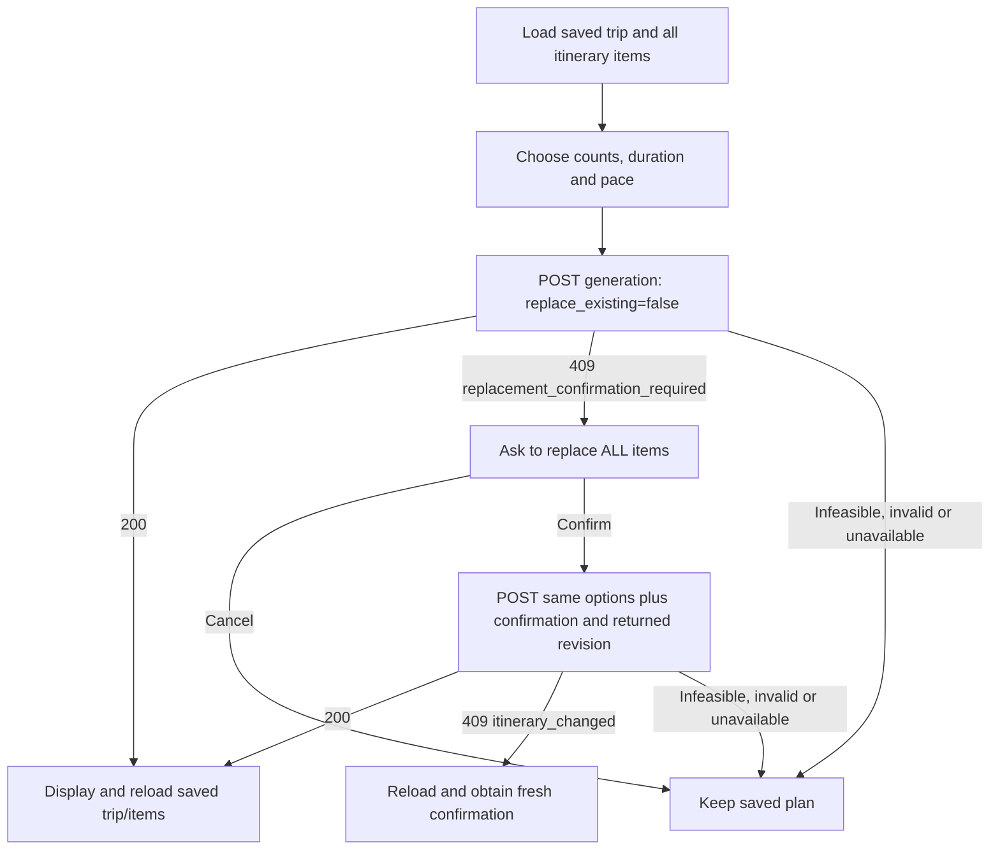

# Roel and coding assistants: START HERE for #56

## Authentication handoff (#79 / #80)

The deployed [Supabase session and backend ownership contract](docs/authentication.md)
supersedes demo-token setup below. Backend #79 passed development, deployed staging
and production ownership verification. Protected calls now require Supabase access
tokens; Flutter sessions/screens remain #80 and teammate acknowledgment is deferred.
Existing compiled demo-token calls receive 401. The #56 payload contract below is
unchanged. Explicit synthetic demo mode is restricted to development/loopback.

**The #54 backend is implemented, merged, deployed and verified. Andrew confirmed
on October 29, 2026 that Roel agreed to this API contract.** This is the frontend
handoff for [#56](https://github.com/relax-mode/lagaw/issues/56), including the
generation flow. The Flutter integration remains #56 work; this handoff adds docs.

Copy this starting instruction into Roel's coding assistant:

```text
Read AGENTS.md and ROEL_START_HERE.md first. Implement the assigned #56 Flutter
integration using the existing #52 interaction, #53 recommendation and #54
generation APIs. Reuse TripService and Trip Details/manual itinerary behavior.
Follow the documented confirmation, reload and failure flows below. Verify on
staging/development first. Keep .env unchanged and use the existing configuration.
Read the linked backend contracts and executable schemas before changing models.
```

## Where to connect

| Environment | API base URL | Swagger | Database |
| --- | --- | --- | --- |
| Staging: develop and verify here first | `https://lagaw-api-staging-i5kvldluga-as.a.run.app` | [Staging docs](https://lagaw-api-staging-i5kvldluga-as.a.run.app/docs) | Development `vnpkyvtbupnquvirzlzp` |
| Production: acceptance after staging passes | `https://lagaw-api-i5kvldluga-as.a.run.app` | [Production docs](https://lagaw-api-i5kvldluga-as.a.run.app/docs) | Production `zjnuqqtbapbpudsjbpif` |

Reuse the frontend's existing `AppConfig`, `TripService` and environment-specific
`TripDemoToken` bearer configuration. The existing demo token is different in
staging and production and selects a server-owned synthetic demo profile. Individual
user authentication is separate work. Flutter calls FastAPI for data and AI work;
Supabase service-role/provider credentials stay in the backend. No `.env` edit or
new key is needed for this handoff. Keep tokens out of chat, logs and source.

## Required screen and API flow

1. **Save/select a trip first.** Use existing Trip CRUD. Keep its returned UUID;
   load `GET /api/v1/trips/{trip_id}` and all pages of
   `GET /api/v1/trips/{trip_id}/items`. Existing `listTripItems()` follows pages.
2. **Collect generation choices explicitly:** party size, total desired visits
   across the whole trip, duration and pace. A group label does not establish party
   size. These choices are request options; current Trip CRUD does not persist them.
3. **Optional recommendation preview:** POST the flat options to
   `/api/v1/trips/{trip_id}/recommendations`. This returns ranked suggestions only;
   it does not save a schedule. Generation performs fresh validated ranking itself.
4. **Generate:** POST the nested generation body below with
   `replace_existing: false`. Disable duplicate in-flight submissions and retain
   the displayed saved plan while the request runs.
5. **Handle the response by status and `detail.code`.** A saved plan requires the
   explicit confirmation/revision flow below. A failed or canceled attempt keeps
   the displayed saved plan.
6. **After HTTP 200:** render the returned ordered `items`, then reload the trip
   and all items from the existing GET endpoints. The trip contains the saved
   `estimated_total_cost`; the items contain saved times, costs and explanations.
7. **On reopening/refresh:** GET the saved trip and items. Opening a screen must
   not trigger generation. Keep the existing manual add/remove actions available.



## Requests: preview and generation have different shapes

Optional recommendation preview, `POST .../{trip_id}/recommendations`:

```json
{
  "party_size": 2,
  "planned_visits": 3,
  "limit": 100
}
```

Generate and persist, `POST .../{trip_id}/generate-itinerary`:

```json
{
  "recommendations": {
    "party_size": 2,
    "planned_visits": 3,
    "limit": 100
  },
  "duration": "morning",
  "pace": "moderate",
  "replace_existing": false
}
```

Use the actual selected trip UUID in the path. Send counts as JSON integers,
not strings/booleans. Generation requires `1 <= planned_visits <= limit <= 100`;
party size is 1–100. `planned_visits` is the required count over the entire trip,
not visits per day. Generation saves a complete feasible count or returns 409.
Trips are at most 31 inclusive days for generation.

The backend reads saved dates, total PHP budgets, tags, group and transport from
the owned trip. Do not put them, `user_id`, selected recommendation rows, location
details or a client-built schedule into this generation body. A recommendation
preview is advisory; the final generated response is authoritative.

Duration values: `morning`, `afternoon`, `evening`, `full_day`, `unspecified`.
Pace values: `slow`, `moderate`, `fast`, `unspecified`. Defaults are full day and
moderate; unspecified has the same effect. Use user-confirmed choices from the
manual form or extraction flow. Generation itself does not call DeepSeek.

## Existing itinerary: require confirmation before replacement

An ordinary generation request for a nonempty trip returns this 409 shape:

```json
{
  "detail": {
    "code": "replacement_confirmation_required",
    "revision": "295151016df684c49343b6834454a279",
    "message": "Confirm replacing all existing itinerary items, including manual items."
  }
}
```

The revision above is illustrative. Use the revision from the **current response**.
Show a dialog explaining that all saved items, including manual additions, will
be replaced. Cancel makes no write. On confirmation, resend the same desired
generation options with `replace_existing: true` and `expected_revision` together:

```json
{
  "recommendations": {
    "party_size": 2,
    "planned_visits": 3,
    "limit": 100
  },
  "duration": "morning",
  "pace": "moderate",
  "replace_existing": true,
  "expected_revision": "295151016df684c49343b6834454a279"
}
```

A stale or replayed confirmation returns 409 `itinerary_changed`. Reload the saved
trip/items, obtain a fresh confirmation response and ask the traveler again.
Changing request choices after a dialog also needs confirmation for those choices.
Do not silently replace a returned revision or automatically retry a confirmed write.

## Response models and display

Generation HTTP 200 is an object with `schema_version`, `trip_id`, `timezone`,
`estimated_total_cost`, `revision`, and `items`. GET items is a different wrapper:
`{"items": [...], "limit": 100, "offset": 0}`. Recommendation results are also
different: their `items` are ranked suggestions with `location_id`, score/reason
and nested location, not persisted itinerary rows.

Extend the existing frontend `TripItem` model to consume these saved item fields:

| Field | Rendering/meaning |
| --- | --- |
| `id`, `trip_id`, `location_id`, `location` | Real saved association and existing nested `LocationItem`; use item ID for removal |
| `day_number`, `visit_order` | One-based day/order; calendar day is trip start date plus day number minus one |
| `arrival_time`, `departure_time` | Nullable local `HH:MM:SS` strings in **Asia/Manila**; do not reinterpret as UTC timestamps |
| `estimated_travel_time` | Nullable incoming journey minutes |
| `estimated_cost` | Nullable **party venue cost plus incoming travel estimate**; do not multiply by party size again |
| `recommendation_score`, `recommendation_reason` | Nullable normalized score and explanation; render the backend reason |

Trip and item monetary values serialize as decimal strings; existing parsers may
also accept numeric JSON. A null manual-item value means unscheduled/unknown and
needs an appropriate empty label. Null is not zero. Preserve API day/order.

## Errors: preserve the current plan and support recovery

**Existing `_itemErrorFor()` treats every 409 as an occupied manual position, and
`_detailText()` reads only string details. Generation needs a dedicated decoder
for object-shaped `detail`, preserving `code`, `revision`, counts and `skipped`.**

| Response | Frontend behavior |
| --- | --- |
| 409 `replacement_confirmation_required` | Show replacement dialog; use the returned revision only after confirmation |
| 409 `itinerary_changed` | Reload; obtain a fresh confirmation; keep the current plan |
| 409 `no_suitable_recommendations` or `requested_visits_do_not_fit` | Show a recoverable no-feasible-plan message and optional skipped reasons; retain saved items/total |
| 422 | Show validation feedback; details may be a string or a sanitized list of `loc`, `msg`, `type` |
| 401/404 | Use the current credential/not-found handling; do not select another owner |
| 503/network/timeout | Keep the plan, show retry; reload before retrying a write because a timeout can follow a successful commit |
| Recommendation HTTP 200 with empty `items` | Show no matches; it is not a generated schedule or a request to erase the plan |

Current eligible saved groups: `solo`, `couple`, `family`, `friends`, `group`.
Approved tags: `cafe`, `photography`, `relaxing`, `heritage`, `food`, `nature`.
Some existing form options (including `students` and additional tags) are outside
that contract: prompt correction through Trip CRUD instead of inventing a mapping
or weakening backend validation. Generation also needs a supported saved transport:
`walking`, `jeepney`, `taxi`, `motorcycle`, `private_car` (generic aliases
`public_transport`/`private_vehicle` are supported).

Unknown opening hours/cost/duration/coordinates can make venues unschedulable.
As last verified during #54 acceptance, eight of ten active production venues had
unknown hours. Setting/accessibility facts are also unverified in the current
catalog; restrictive requests may legitimately have no matches. Never invent
hours, force an empty plan into storage, or add catalog fixtures to production
to make a frontend test pass. Detailed policies are in the backend guides below.

## Manual actions and interaction controls

Keep existing `addTripItem()` and `removeTripItem()` behavior. Manual POST accepts
only `location_id`, `day_number`, `visit_order`; it returns 201 with null generated
fields. Use an unoccupied order within saved trip days. Manual DELETE uses the
saved **item ID**, returns 204 with no body and preserves the destination.
Reload trip/items after either action. The complete-plan total becomes null;
remaining generated item metadata stays saved. A confirmed regeneration restores
a complete validated schedule/total and replaces item IDs.

For #56's swipe/save/rating UI, use the existing #52 interaction endpoint and
[interaction contract](docs/interactions-api.md). It appends events; identical
retries can create duplicates. A left swipe remains a hard exclusion, and there
is no unsave/unreject endpoint in #52. Refresh recommendation results as needed;
do not invent API routes or write directly to Supabase.

## Files and verification checklist for the coding assistant

- Reuse [TripService](frontend/lib/services/trip_service.dart),
  [TripItem](frontend/lib/models/trip_item.dart),
  [Trip Details](frontend/lib/screens/trip_detail_screen.dart), and
  [itinerary section](frontend/lib/widgets/itinerary_section.dart).
- Read [generation contract](docs/itinerary-generation-api.md),
  [recommendation contract](docs/trip-recommendations-api.md),
  [manual items contract](docs/trip-items-api.md), and the environment's
  `/openapi.json`. Executable generation schemas live in
  [itinerary_schemas.py](backend/app/itinerary_schemas.py).
- Add #56 mocked service/widget coverage for generation, object-shaped 409 codes,
  cancel/confirm/stale revision, infeasible/network failures retaining the plan,
  refresh/reopen reload, nullable manual fields, and manual edits followed by regeneration.
- Run Flutter checks per [regression testing](docs/regression-tests.md), then
  verify the #56 UI in staging before production acceptance.
- [#54 evidence](docs/evidence/itinerary-generation.md) contains archived successful
  payloads for understanding/parsing. **All acceptance fixture IDs were cleaned**;
  use current real API records for integration. The completed cleanup SQL is evidence
  and must not be replayed as setup.

Andrew's #54 backend work is complete. Roel's #56 UI implementation and its tests
remain assigned to Roel; this note makes the agreed API and flow explicit.
