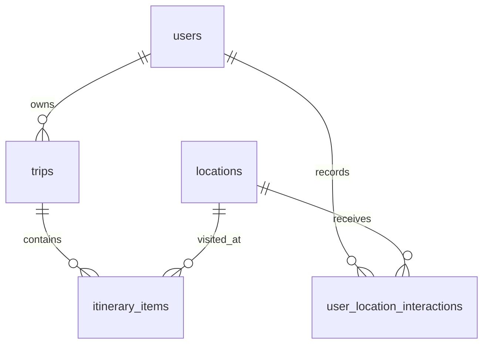

# Lagaw database

This covers the original **S1-01 PostgreSQL schema** and **issue #22 trip and
itinerary relationship verification**. The field list follows
[the approved pitch](pitch.md#3-database-schema-sketch). The original migration is
`supabase/migrations/20261014114320_initial_lagaw_schema.sql`.
Sample destinations and the existing FastAPI endpoint are documented in
[the locations API guide](locations-api.md).

## Tables and relationships

| Table | Purpose | Foreign keys |
| --- | --- | --- |
| `users` | Traveler profiles and default preferences | None |
| `locations` | Administrator-managed destination records | None |
| `user_location_interactions` | Swipe, save, and rating events | `user_id → users.id`, `location_id → locations.id` |
| `trips` | Main CRUD resource | `user_id → users.id` |
| `itinerary_items` | Ordered visits within trips | `trip_id → trips.id`, `location_id → locations.id` |



All IDs are UUIDs generated by PostgreSQL. Money uses `numeric(12,2)` in PHP;
coordinates use `numeric(9,6)`; tag/group lists use `text[]`; opening hours use
`jsonb`; creation timestamps use `timestamptz`. Dates/times in itineraries refer
to Bacolod local time (Asia/Manila). Durations are whole minutes, and day/order
numbers start at 1. Unknown costs, schedules, scores, and profile budgets can be
NULL; unknown values are not silently treated as zero.

Opening hours must be an object. Example:

```json
{"monday": [{"open": "09:00", "close": "18:00"}]}
```

An empty object means hours have not been supplied. Weekday names, time formats,
overnight intervals, and holiday exceptions need backend validation when the
planner is implemented. The database does not enforce departure after arrival,
since a visit may cross midnight. Trip-day bounds, schedule conflicts, approved
tags, and geographic/budget filters belong to backend/planner validation.

## Integrity and lifecycle

- Costs and budgets must be nonnegative, finite, and ordered when both bounds exist.
- Coordinates must be supplied together and stay within latitude/longitude limits.
- Trip end dates cannot precede start dates. Visit durations must be positive;
  travel durations may be zero.
- Interaction values use `left_swipe`, `right_swipe`, `save`, and `rating`.
  Only rating events carry a non-null `rating_value`; numeric values must be finite.
  Multiple events per user/location are allowed. Event aggregation and recommender
  weights are backend/AI decisions.
- `status` defaults to `draft`; it remains nonempty text until the team agrees on
  the complete lifecycle. A trip can be archived by updating this field.
- Deleting a trip removes its itinerary items. Deleting a user removes their
  trips, itinerary items, and interactions.
- Referenced locations cannot be deleted. Set `is_active = false` to retire them
  while retaining history. An unreferenced location can be deleted.
- `(trip_id, day_number, visit_order)` is unique. All foreign keys have an index
  whose leading columns support their lookups; there is no duplicate trip index.
- Email uniqueness is case-sensitive in this initial schema; authentication must
  define email normalization before account creation is integrated.

## Access model

The course requires **Flutter → FastAPI → PostgreSQL**. Each application table
has RLS enabled, and table privileges are revoked from `PUBLIC`, `anon`, and
`authenticated`. No client-facing RLS policies are supplied: those client roles
must call FastAPI for application data.

The server-only `service_role` has SELECT/INSERT/UPDATE/DELETE privileges and
bypasses RLS. FastAPI must authenticate requests and enforce ownership and
administrator permissions. A future direct SQL backend role must be configured
explicitly rather than assuming it can use the service-role grants. Never put
database passwords or service-role credentials in Flutter or source control.

`public.users` is a profile table. This issue does not create passwords,
Supabase Auth accounts, or an `auth.users` synchronization trigger.

## Verify on a hosted test project (no local Docker required)

The team confirmed these Supabase **project IDs** on October 20, 2026:

| Environment | Project ID |
| --- | --- |
| Test/development | `vnpkyvtbupnquvirzlzp` |
| Production | `zjnuqqtbapbpudsjbpif` |

Implement and test in development before production. CLI linkage and backend
environment variables select their targets independently; linking the CLI does
not change `DATABASE_URL`, `SUPABASE_URL`, or the matching backend API key.

The initial migration has been applied to development using the Supabase CLI.
To set up another empty hosted test project,
run these commands in PowerShell from the repository root:

```powershell
npx supabase link --project-ref YOUR_TEST_PROJECT_REF
npx supabase db push --dry-run
npx supabase db push
npx supabase migration list
```

To verify the applied schema, copy the smoke-test SQL in **PowerShell**:

```powershell
Get-Content -Raw supabase/tests/schema_smoke.sql | Set-Clipboard
```

Open the **test project's SQL Editor**, paste the copied SQL file contents into
a new query, and run the entire script as the database owner (`postgres`). Do not
paste the PowerShell command into SQL Editor. The SQL begins with `begin;` and
ends with `rollback;`, so its temporary verification records are not retained.
`Success. No rows returned` with no errors means the checks passed.

On 2026-10-14, the developer reported a successful CLI migration application and
a complete smoke-test run returning `Success. No rows returned` on this project.
This is hosted test verification; GitHub CI, PR review/merge, and production
deployment are still pending. Sample locations and API endpoints remain S1-02.

## Optional local verification with Supabase

Install Docker Desktop and the Supabase CLI (or use Node 20+ with `npx`). Start
Docker Desktop and run these commands from the repository root:

```powershell
npx supabase start
npx supabase db reset --local
```

The reset **erases local data** and reapplies migrations. Seeding is disabled
for S1-01; the resulting application tables are empty.

Copy `.env.example` to `.env` and configure the backend's database settings when
the API is implemented. Use `npx supabase status` privately to obtain local
connection details. The local database normally listens on `127.0.0.1:54322`.

With `psql` installed, run the transactional smoke test on the local database:

```powershell
$env:PGHOST = '127.0.0.1'
$env:PGPORT = '54322'
$env:PGDATABASE = 'postgres'
$env:PGUSER = 'postgres'
psql -W --no-psqlrc --set=ON_ERROR_STOP=1 --file supabase/tests/schema_smoke.sql
```

Enter the local database password when prompted. The test checks CRUD, defaults,
joins, rejected input/FKs, repeated interaction events, cascades, role grants,
actual client-role denials, and actual server-role CRUD. It rolls back all test
fixtures and temporary helper functions. An error must be investigated, not
ignored.

## CI and a disposable PostgreSQL test database

[Database CI](../.github/workflows/database.yml) starts PostgreSQL 17, creates the
Supabase-compatible test roles, applies migrations in timestamp order, and runs
the smoke test. It uses only a disposable CI database and needs
no hosted Supabase secrets. Any failed SQL statement fails the job.
After the SQL smoke test, it installs the backend dependencies and runs
`python backend/verify_trip_relationships.py --ci` against that same disposable
database. A relationship verification failure also fails the job. The ordinary
backend regression suite remains offline.

For an equivalent fresh vanilla PostgreSQL database, configure the usual `PG*`
connection variables privately and run:

```powershell
python scripts/check_database.py --bootstrap-roles
```

This runner applies DDL; use it only on a fresh disposable database.
Do not use `--bootstrap-roles` on Supabase, where these roles already exist.
For an existing local Supabase stack, use `db reset --local` and the smoke-test
command above instead of reapplying initial DDL.

## SQLAlchemy trip relationships (issue #22)

`backend/app/models.py` maps the existing `users`, `trips`, `itinerary_items`, and
`locations` tables. `back_populates` connects `User.trips` with `Trip.user`,
`Trip.itinerary_items` with `ItineraryItem.trip`, and `Location.itinerary_items`
with `ItineraryItem.location`. PostgreSQL continues enforcing the constraints
installed by the migrations. Do not create or replace tables with `create_all()`.

Deleting a trip deletes its itinerary items, through both the mapped cascade and
the existing PostgreSQL `ON DELETE CASCADE`. Its user and destinations remain.
The location mapping preserves PostgreSQL's restriction on deleting referenced
destinations.

The required columns, non-null foreign keys, and trip cascade already exist in
the Sprint 1 migration. No new schema migration is required for issue #22, and no
existing migration was changed. The issue mentions Alembic, but this repository
uses Supabase SQL migrations; Alembic has not been introduced as another migration
owner. If a later schema gap is identified, resolve that tooling mismatch before
adding a migration. ORM mappings alone do not establish a migration baseline.

For development, privately configure `DATABASE_URL` from the development
project's **Connect → Session pooler → URI** panel. Replace the password
placeholder with the database password, URL-encode reserved password characters,
and use the `postgresql+psycopg://` driver prefix. The hostname and pooled username
must come from that project's copied URI. Keep the complete value private.

`backend/app/db_session.py` loads this configuration only when requested, using
environment variables ahead of `.env`. Hosted connections require SSL. The
locations endpoint still uses its existing Supabase Data API configuration;
adding the ORM verifier does not switch that endpoint to a different database
client or require a new production database secret.

Run from the repository root:

```powershell
.\.venv\Scripts\python.exe backend/verify_trip_relationships.py
```

The verifier permits the known development project and refuses production. It
creates a temporary user and trip with two itinerary items linked to the existing
San Sebastian Cathedral and The Negros Museum UUIDs. It reloads the relationships,
checks invalid and missing foreign keys, exercises the trip deletion cascade,
preserves the user and destinations, and rolls back its fixture transaction even
on failure. A fresh session checks that the fixtures did not persist.

The explicit `--ci` mode permits only a loopback `lagaw_test` database. Database CI
supplies its disposable connection string and `sslmode=disable`; disabling SSL is
accepted only for loopback connections. No real hosted credentials are needed in
CI. Do not use the fresh-database migration runner on an existing hosted project.

[Development evidence](evidence/trip-relationships-dev.md) records the five PASS
lines reported by the developer on October 20, 2026, and the successful local
`GET /locations` response listing all ten seeded destinations on October 21.
GitHub CI, reviewed merge, and production verification remain pending. These
development results are not a claim that production was checked.

## Deploy after review

Keep schema changes in migration files and merge them through a reviewed PR
with passing CI. The separate hosted test project is already available; confirm
the production target with the team before deployment. Supabase CLI `link` and
Codex MCP authentication are separate connections. Linking the CLI to the test
project does not switch an existing project-scoped MCP connection.

The deployment owner or CI then uses the merged checkout:

```powershell
npx supabase link --project-ref YOUR_PROJECT_REF
npx supabase db push --dry-run
npx supabase db push
npx supabase migration list
```

Never reset the hosted database to apply this migration. Avoid applying the same
SQL independently through MCP with a different migration version; local filenames
and hosted migration history must agree. Future changes get new migration files;
do not edit an initial migration after deployment.

Confirm the five tables, FKs, checks, RLS, grants, and migration history in the
target environment. Only after reviewed merge, passing CI, deployment, and hosted
verification does the course's Definition of Done consider the issue complete.

## Pitch gaps for follow-up

The pitch describes accessibility and indoor/outdoor filters, approved tag
matching, and extracted pace/duration preferences, but its five-table sketch
does not fully model those attributes. This migration preserves the approved
field list. Agree on those additions with the team and record them in subsequent
migrations/scope documentation. The rating scale, complete trip-status vocabulary,
and identity integration also need agreement before their features are built.
