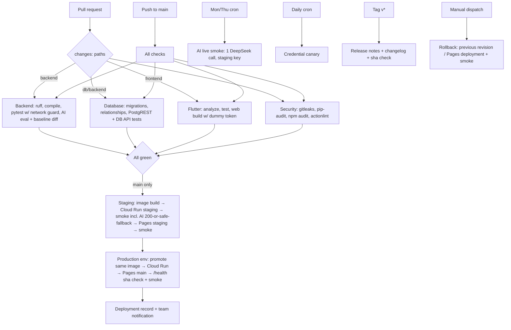

# DevOps Implementation Plan (CyGray)

Snapshot date: **October 25, 2026**. Owner: CyGray (Kyle), DevOps Engineer.

This plan covers:

1. Every open issue assigned to CyGray: [#30](https://github.com/relax-mode/lagaw/issues/30), [#31](https://github.com/relax-mode/lagaw/issues/31), [#58](https://github.com/relax-mode/lagaw/issues/58), [#59](https://github.com/relax-mode/lagaw/issues/59).
2. Every DevOps deliverable required by [the official instructions](official-instructions.md) (Sections 4, 5, 7, 8 and 9) that no open issue tracks yet.
3. A ranked backlog of pipeline, workflow, security and developer-experience improvements.

Ground truth: [`docs/pitch.md`](pitch.md) and [`docs/official-instructions.md`](official-instructions.md). Where the repository disagrees with them, the conflict is listed in [Section 2](#2-conflicts-to-flag), not worked around.

## Progress, October 26

| Plan item | Outcome |
|---|---|
| #30 staging acceptance (Section 4) | Done; PR [#67](https://github.com/relax-mode/lagaw/pull/67) in review. A browser write landed in development only; production unchanged. |
| #31 gates, optimization, incidents (Section 5) | Done; PR [#68](https://github.com/relax-mode/lagaw/pull/68) in review. O-1 path filters (docs-only PRs 83 s → 9 s), O-2 `psql` (8 s → 0 s), O-8 timeouts, per-run concurrency (fixes INC-2), Ruff pin, `db` test hook, metrics script, incident log. Left open: the #29 tests. |
| #58 AI CI/CD (Section 6) | Done; PR [#73](https://github.com/relax-mode/lagaw/pull/73), stacked on #68, in review. Covers the evaluation gate against the target-branch baseline, the network guard, DeepSeek keys in Secret Manager (holder Kyle), the `production` environment, automatic promotion (C-1, C-4, C-5), the scheduled live checks (6.5, B-17), and the scope change for C-2. Deployed production verification waits for the merge and for #53/#54. |
| #59 Sprint 3 record (Section 7) | Plan table, risks, consultation pack, and team roles in the README. Standups and the retrospective are recorded only as they happen. |
| New finding | [INC-3](incident-log.md#inc-3-production-drifted-behind-main): production was four days behind `main` under manual deploys. |
| Still open (Sections 8–9) | Rollback workflow and drill, releases and changelog, secret scanning and dependency audit, Dependabot, per-environment Cloudflare tokens and deployer identities, health endpoint and uptime monitoring. |

The rest of this document is the October 25 plan, unchanged.

Numbers come from GitHub Actions and the GitHub API as of the snapshot date. They describe the last 100 runs (about October 15 to 25). Re-measure before quoting them at a consultation.

---

## Contents

1. [Current state](#1-current-state)
2. [Conflicts to flag](#2-conflicts-to-flag)
3. [Schedule](#3-schedule)
4. [Issue #30: staging environment and isolated secrets](#4-issue-30-s2-07-staging-environment-and-isolated-secrets)
5. [Issue #31: API tests in CI and quality gates](#5-issue-31-s2-08-api-tests-in-ci-and-quality-gates)
6. [Issue #58: AI tests and evaluation checks in CI/CD](#6-issue-58-s3-13-ai-tests-and-evaluation-checks-in-cicd)
7. [Issue #59: Sprint 3 record and consultation evidence](#7-issue-59-s3-14-sprint-3-record-and-consultation-evidence)
8. [Instruction-required DevOps work not yet tracked](#8-instruction-required-devops-work-not-yet-tracked)
9. [Improvement backlog](#9-improvement-backlog)
10. [Target pipeline](#10-target-pipeline)
11. [New issues to open](#11-new-issues-to-open)
12. [Risk register](#12-risk-register)
13. [Appendix: commands and snippets](#13-appendix-commands-and-snippets)

---

## 1. Current state

### Pipeline (`.github/workflows/ci.yml`, the only workflow)

| Job | Trigger | What it does | Typical duration |
|---|---|---|---|
| `Backend - Python` | PR, main push, dispatch | pip-cached install, unpinned Ruff, `compileall`, `pytest -v` (about 155 test functions; 293 tests with PR #66) | 18–29 s |
| `Database - PostgreSQL migrations and smoke tests` | PR, main push, dispatch | Postgres 17 service, `apt-get install postgresql-client`, migrations + schema smoke, SQLAlchemy relationship verifier, disposable PostgREST and the trip-items verifier | 35–71 s |
| `Frontend - Flutter` | PR, main push, dispatch | `flutter pub get`, `flutter test`, `flutter analyze`, release web build (production `API_BASE_URL` and production `TRIP_DEMO_TOKEN`), artifact upload | **77–93 s (the bottleneck)** |
| `Decide - Staging deployment` | main push | Diffs `before..sha` to decide whether the backend and/or web need deploying | about 5 s |
| `Deploy - Staging` | main push, after all three checks, `staging` environment | Builds and pushes the staging image, deploys Cloud Run `lagaw-api-staging`, `scripts/smoke_staging.py`, rebuilds Flutter against staging, deploys the Pages `staging` branch, HTTP smoke | 95–105 s |
| `Deploy - Cloud Run` | **`workflow_dispatch` on main only** | Builds the image and deploys `lagaw-api`, then smoke-tests `/locations?limit=1` | no run in the window |
| `Deploy - Cloudflare Pages` | **`workflow_dispatch` on main only** | Deploys the PR-job web artifact to Pages `main`, then an HTTP smoke | no dispatch run in the window |

### Measured snapshot (`Lagaw CI`, 66 runs)

| Metric | Value |
|---|---|
| Success rate | **92.4%** (61 success, 2 failure, 3 cancelled) |
| PR wall time, median / p90 | **90 s / 144 s** (successful runs) |
| Main push wall time, median / p90 | **108 s / 244 s** (successful runs) |
| Failures | 2, both `Deploy - Staging` → "Deploy staging Flutter Web" (Cloudflare auth): [39743812096](https://github.com/relax-mode/lagaw/actions/runs/39743812096), [40098046876](https://github.com/relax-mode/lagaw/actions/runs/40098046876) |
| Anomalies | Push runs [39746663078](https://github.com/relax-mode/lagaw/actions/runs/39746663078) and [39743812096](https://github.com/relax-mode/lagaw/actions/runs/39743812096) show about 53 h of wall time. The likely cause is waiting on the old `staging` required-reviewer rule; this is unverified (see [I-2](#incident-log-seed)). |
| Production deploys via `Lagaw CI` | 0 in the window. Older push runs deployed Pages before "chore: make production deployments manual". |

### Repository settings

- **Branch protection on `main`:**
  - 3 required checks, strict (branch must be up to date).
  - 1 approving review, with stale approvals dismissed.
  - Rules apply to admins.
  - Force pushes and branch deletion are blocked.
  - Not set: conversation resolution, linear history, rulesets.
- **Environments:** only `staging`, restricted to protected branches with no required reviewer. There is **no `production` environment**.
- **Repository secrets:** `CLOUDFLARE_API_TOKEN`, `CLOUDFLARE_ACCOUNT_ID`, `TRIP_DEMO_TOKEN`. Any workflow on any branch can read these.
- **Staging environment:** secret `STAGING_TRIP_DEMO_TOKEN`, variable `STAGING_TRIP_DEMO_USER_ID`.
- **Not configured:** Dependabot (alerts disabled, no `.github/dependabot.yml`), secret scanning job, dependency audit, CODEOWNERS, PR template.

### Gaps against the course's "mature pipeline" stages (Section 5)

| # | Stage | Status |
|---|---|---|
| 1 | Install (cached) | ✅ pip, pub and Docker gha caches. The `apt-get` step is not cached. |
| 2 | Lint / format | ✅ Ruff (unpinned), `flutter analyze`. ❌ no format check. |
| 3 | Type check | ❌ none (Python has none; Dart gets analysis only). |
| 4 | Unit tests, LLM mocked | ✅ mocked provider transport. ❌ no network guard proving it. |
| 5 | Build | ✅ web bundle. Container image is built only in deploy jobs. |
| 6 | Integration vs test DB | ✅ disposable Postgres + PostgREST. #29 DB-backed API tests are still pending. |
| 7 | Security checks | ❌ **missing**: no secret scan, no dependency audit. |
| 8 | Staging deploy | ✅ automatic on main. |
| 9 | Smoke tests | ✅ staging API (read-only) + Pages HTTP; production `/locations`. |
| 10 | Promote / deploy production | ⚠️ **manual dispatch**, which conflicts with the rubric (see C-1). |
| 11 | Post-deploy health check + team notification | ⚠️ smoke only. ❌ no notification, no uptime monitoring, no `/health` endpoint. |

---

## 2. Conflicts to flag

Raise these on the relevant issue and in the sprint log; do not silently resolve them.

| ID | Conflict | Ground truth | Recommendation |
|---|---|---|---|
| **C-1** | Production deploys only on manual `workflow_dispatch`. The #31 text says "production deployments require manual workflow dispatch". | Instructions §4 ("Merged work deploys automatically") and §5 ("deploys every merge to main without manual steps"). The rubric's "Automation and quality gates" excellent band requires "Zero manual deploy steps". The pitch §4 says merges to `main` deploy production automatically. #58 explicitly says to follow the approved docs and flag #31's wording. | Automate production on main push, **promoted after staging smoke passes** (Section 6.4). Keep `workflow_dispatch` only for redeploy and recovery. Comment on #31 that its manual-production line is superseded, citing #58 and §5. |
| **C-2** | No per-PR preview deployments. | Pitch §4 says "each pull request that changes the frontend gets its own preview deployment". Instructions call previews "ideally" (optional). | Either add Pages previews for same-repo PRs (Section 9, B-12) or record a scope change: "staging replaces per-PR previews", with the reason (backend previews would need a Cloud Run service per PR). |
| **C-3** | `PIPELINE.md` says "The current 69-test suite"; there are now about 155 test functions (293 tests with PR #66). It also says production is manual. | Accuracy of the submitted pipeline doc (rubric: "Metrics, documentation, and reporting"). | Rewrite `PIPELINE.md` after the C-1 change lands. Avoid hard-coded test counts; link to the run summary instead. |
| **C-4** | Production Cloud Run deploy declares only `CORS_ALLOWED_ORIGINS` and the two Supabase secrets. `TRIP_DEMO_USER_ID`, `TRIP_DEMO_TOKEN` and `DEEPSEEK_*` are not declared, so any production values exist only as manual service config (configuration drift). | Instructions §3 req. 6 ("secrets injected per environment"); #58 Deployment and Secrets. | Declare every production variable and secret reference in the workflow (Section 6.3). Check the live service by **names only** (Appendix 13.2). |
| **C-5** | Production secrets use `:latest`; staging pins versions. With `:latest`, a Cloud Run rollback does not roll back secrets. | Rollback requirement (§5 "Release and rollback"). | Pin production secret versions the same way staging does, and document rotation in the runbook. |
| **C-6** | `docs/cicd-best-practices.md` says the deploy job "compares the changed files" (a path filter on production). That logic now exists only for staging. Pitch §4 DevOps Tooling describes push-to-main production deploys and PR previews. | Pitch is ground truth. | Update the pitch's DevOps Tooling paragraph and `cicd-best-practices.md` in the same PR that resolves C-1/C-2. |
| **C-7** | Pitch lists LightFM; the hybrid recommender uses NumPy truncated SVD ([`hybrid-recommender.md`](hybrid-recommender.md)). | Pitch §2/§4. | Not a DevOps change. Ask the AI owner to add it to [`scope-changes.md`](scope-changes.md). It also matters to DevOps because no native LightFM build is needed in the image. |

---

## 3. Schedule

The Sprint 2 milestone was due **October 25** (today). The Sprint 3 milestone is due **November 1**. Sprint 4 runs roughly November 2–8, then Demo Day.

| When | Work | Closes |
|---|---|---|
| Oct 25–26 | Finish #30 acceptance evidence (Section 4). Post the C-1 conflict comment. Finish the #31 measurement and documentation gaps (Section 5). | #30, #31 |
| Oct 26–27 | PR `chore/production-auto-deploy`: `production` environment, promotion after staging, pinned secrets, declared production config (Sections 6.3–6.4). | C-1, C-4, C-5 |
| Oct 27–28 | PR `chore/security-gates`: secret scan, dependency audit, Dependabot, pinned tools (Section 9). | Rubric stage 7 |
| After PR #66 merges | PR `test/ai-ci-integration`: evaluation report and baseline diff, network guard, deliberate-failure proof (Sections 6.1–6.2). | #58 §1 |
| Oct 28–30 | DeepSeek key provisioning (staging, then production), deployed AI-path verification, scheduled live smoke workflow (Sections 6.3, 6.5). | #58 §2 |
| Oct 30–31 | Sprint 3 metrics row, incident log, pipeline report, live-demo checklist (Sections 6.6, 7). | #58 §3, #59 |
| Nov 1 | Sprint 3 consultation. Record feedback and the retrospective afterwards. | #59 |
| Nov 2–8 | Release and rollback workflows, tested rollback drill, `v1.0.0` + changelog, optimization round 2, runbook, live-deploy rehearsal (Section 8). | Sprint 4 DevOps checklist |

---

## 4. Issue #30 (S2-07): staging environment and isolated secrets

**Status:** most of the infrastructure exists ([`docs/staging.md`](staging.md), [staging incident evidence](evidence/staging-incident-2026-10-25.md)). Five successful `Deploy - Staging` runs exist after the Cloudflare token replacement: [40163301832](https://github.com/relax-mode/lagaw/actions/runs/40163301832), [40163792050](https://github.com/relax-mode/lagaw/actions/runs/40163792050), [40166582182](https://github.com/relax-mode/lagaw/actions/runs/40166582182), [40171568084](https://github.com/relax-mode/lagaw/actions/runs/40171568084), [40198825051](https://github.com/relax-mode/lagaw/actions/runs/40198825051). What remains is acceptance evidence and documentation.

### Task-by-task status

| Task | Status | Remaining action |
|---|---|---|
| Staging FastAPI deployment | ✅ `lagaw-api-staging` | none |
| Staging Flutter Web hosting | ✅ in workflow (Pages `staging` branch) | Confirm at least one of the successful runs above actually **ran** (not skipped) the "Deploy staging Flutter Web" step. If none did, push a frontend-touching change or rerun after a qualifying merge. |
| Isolated staging DB | ✅ development Supabase project, separate from production | Record explicitly that staging shares the **development** project with local developer testing (see R-6). |
| Separate env variables | ✅ `STAGING_*` variables and secrets, separate WIF provider and runtime SA | none |
| Secrets in the hosting environment | ✅ Secret Manager with pinned versions; GitHub `staging` environment | none |
| Automated triggers | ✅ main push → staging after checks | none |
| Staging frontend → staging backend | ✅ built with the staging Cloud Run URL | Verify in a browser (below). |
| Verify DB isolation | ⚠️ API-level done Oct 25 | Browser write → row present in development, absent in production (below). |
| Production still functional | ⚠️ revision unchanged | Browser check of `https://lagaw.pages.dev` against production. |
| Document URLs and procedures | ✅ `docs/staging.md` | Add the final evidence links. |

### Steps to close

1. **Pick the evidence run.** `gh run view <id> --json jobs -q '.jobs[] | select(.name=="Deploy - Staging") | .steps[] | "\(.name): \(.conclusion)"'`. Use the newest run where both the backend and web deploy steps are `success`.
2. **Browser acceptance (staging).**
   - Open `https://staging.lagaw.pages.dev`.
   - Confirm locations load, then create a trip titled `staging-isolation-<date>`.
   - Open DevTools → Network and confirm the requests go to `lagaw-api-staging-…run.app` and return the expected CORS header.
   - Take screenshots for the evidence file.
3. **Isolation proof.**
   - In the **development** Supabase SQL editor: `select id, title from trips where title like 'staging-isolation-%';` should return the row.
   - The same query in **production** should return 0 rows.
   - Delete the development row afterwards.
   - Record IDs only, never keys.
4. **Production health.** Open `https://lagaw.pages.dev`, confirm the locations list loads from `lagaw-api`, and record the production revision name (`gcloud run services describe lagaw-api --region asia-southeast1 --format='value(status.latestReadyRevisionName)'`).
5. **Credential exposure check.** Search the evidence run logs for secrets: `gh run view <id> --log | rg -i "sb_secret_|service_role|Bearer "` should find nothing (GitHub masking should also show `***`). Note in the evidence that the compiled `TRIP_DEMO_TOKEN` is public by design and the staging profile is synthetic.
6. **Write evidence.** Create `docs/evidence/staging-acceptance-2026-10-2x.md` with the run URL, the staging and production revision names, the screenshots, and the SQL results (no values). Link it from `docs/staging.md` and the issue.
7. **PR.** Open `docs/staging-acceptance` with the evidence, a sprint-log entry and the staging.md update. After review and merge, comment on #30 with links and close it.

---

## 5. Issue #31 (S2-08): API tests in CI and quality gates

**Status:** pytest runs in CI, disposable Postgres and PostgREST exist, branch protection is configured, and one optimization (pip cache in the DB job) is measured with a single baseline run. Remaining work: the production-deploy conflict, verification evidence, a stronger measurement, documentation and the incident log.

### 5.1 Automated API test integration

| Task | Status | Action |
|---|---|---|
| Integrate #29 pytest suite | ⚠️ HTTP CRUD tests run (mocked Supabase). DB-backed API tests from #29 are not merged. | When #29 lands, add a step in the **Database** job (it already has Postgres + PostgREST). Do not add a new job: `python -m pytest -v -m db` with `SUPABASE_URL=http://127.0.0.1:53000`. Ask Andrew to register a `db` marker in a `backend/pytest.ini` so the backend job runs `-m "not db"`. |
| Python env + deps | ✅ | Pin Ruff in `requirements-dev.txt` (B-6). |
| Isolated test DB | ✅ `postgres:17` service, `local_ci_only` credentials | none |
| Runs on every relevant PR | ✅ (every PR) | Path filters later (B-1) keep the required checks green when skipped. |
| Failing test fails CI | ⚠️ not demonstrated | **Deliberate-failure proof:** on a throwaway branch `test/ci-failure-proof`, add `assert False` to one backend test. Open a **draft** PR, record the red run URL, then close it without merging. Repeat for a Flutter test. Link both runs in #31. |
| CI never touches staging/prod | ⚠️ true for tests, but the **Frontend job receives the production `TRIP_DEMO_TOKEN` secret on every PR run** | Fix in B-3: PR builds use a dummy token; the real production build moves into the `production` environment deploy job. Then the evidence statement is "no PR job has access to any staging or production credential". Prove it by listing job `env`/secrets in the workflow. |

### 5.2 Quality gates and deployment reliability

| Task | Action |
|---|---|
| Lint and build checks functional | Cite a green run per job. |
| Branch protection / rulesets | ✅ Done. Optionally add **require conversation resolution** and a **CODEOWNERS** rule so `.github/**` changes need DevOps review (B-9). Screenshot Settings → Branches for the evidence. |
| Staging auto-deploy | ✅ cite run [40198825051](https://github.com/relax-mode/lagaw/actions/runs/40198825051). |
| Production deploy policy | Apply **C-1** (Section 6.4). Comment on #31 that its manual-production acceptance line is replaced by automatic promotion per the instructions and #58. |
| Failed CI cannot deploy production | Already structural (`needs: [backend, database, frontend]`). Keep it in the new promotion job, and evidence it with the deliberate-failure run, where the deploy jobs show *skipped*. |
| Post-deploy smoke | ✅ exists. Strengthen with the `/health` endpoint (B-15) and a version check: the deployed revision reports `GIT_SHA` equal to the merged commit. |
| Production frontend functional | Browser check plus Pages smoke, as in #30 step 4. |

### 5.3 Pipeline optimization (make the measurement defensible)

The current pip-cache result rests on **one baseline run**, as the metrics log admits. Strengthen it, or pick a larger optimization:

1. **Baseline.** Use `scripts/pipeline_metrics.py` (Appendix 13.4) to collect per-job durations for the last 10 PR runs before the change. Report the median and p90, not single runs.
2. **Bottleneck.** `Frontend - Flutter` at 77–93 s is the slowest job in every sampled run; the PR critical path is about 90 s.
3. **Optimization (pick one now, keep the others for Sprint 4):**
   - **O-1 path filters.** Docs-only and backend-only PRs skip the Flutter job (job-level `if`, so skipped required checks report success). Expected effect: docs and backend PRs drop from about 90 s to about 45 s (bounded by the DB job). **Recommended for #31:** the change is large and easy to measure.
   - **O-2 drop `apt-get install postgresql-client`.** `ubuntu-latest` already ships `psql`; verify with `psql --version` first. Expected saving is about 8 s or more per DB job.
   - **O-3 skip the web artifact upload on PRs.** The artifact is only consumed by the production deploy. Expected saving is a few seconds.
4. **After.** 10 runs of the same event type after the change, with medians compared.
5. **Record.** Add an entry to `docs/pipeline-metrics.md` with the run IDs, cache state, medians and what was learned.

### 5.4 Monitoring and documentation

- **Metrics log:** fill the Sprint 2 row of the official table (Appendix 13.4 computes every column).
- **Incident log:** create `docs/incident-log.md` and seed it with I-1 and I-2 (below).
- **`PIPELINE.md`:** update the stages, triggers, gates and test-count wording (C-3). Redraw the diagram if C-1 lands.
- **Evidence:** link runs, the protection screenshot, metrics and incidents in a #31 comment.

#### Incident log seed

| ID | Date | What | Root cause | Fix | Prevention |
|---|---|---|---|---|---|
| I-1 | Oct 2x–25 | `Deploy - Staging` failed at "Deploy staging Flutter Web" (runs 39743812096, 40098046876). Staging Pages returned 404. | GitHub `CLOUDFLARE_API_TOKEN` was rejected by Cloudflare (codes 10000/9109). | Kyle replaced the token with an account-scoped Pages Edit token; run 40163301832 passed. | Token expiry and rotation reminder. Separate staging and production tokens in environment secrets (B-2). A scheduled credential canary (B-17). |
| I-2 | Oct 2x | Main push runs [39746663078](https://github.com/relax-mode/lagaw/actions/runs/39746663078) (cancelled) and [39743812096](https://github.com/relax-mode/lagaw/actions/runs/39743812096) (failed) show about 53 h of wall time; [39745804329](https://github.com/relax-mode/lagaw/actions/runs/39745804329) was cancelled after 7 min with no job records. | **Unverified.** Most likely they were waiting on the former `staging` required-reviewer approval. Check with `gh api repos/relax-mode/lagaw/actions/runs/39746663078/approvals` and `.../timeline`. | Reviewer rule removed (staging now protected-branches only). | Job `timeout-minutes` on every job. Do not use required reviewers on the auto-deploy path. |

---

## 6. Issue #58 (S3-13): AI tests and evaluation checks in CI/CD

**Dependencies:**

- PR [#66](https://github.com/relax-mode/lagaw/pull/66), the Week 3 evaluation suite for #57. It is green and adds `backend/evaluate_week3.py`, `test_week3_evaluation.py`, 12 success and 15 regression fixtures, and committed baseline `docs/evidence/week3-evaluation.json`.
- #53/#54, the recommendation and itinerary endpoints, for deployed verification.

### 6.1 Integrate mocked regressions and the evaluation set (extend, don't duplicate)

`test_week3_evaluation.py` is collected by the existing `pytest` step automatically once #66 merges, so the **mocked AI regression gate already exists** at that point. Add only what pytest does not give:

1. **Evaluation report + baseline drift check** in the existing **Backend** job:

   ```yaml
         - name: Evaluate AI fixtures (offline, mocked provider)
           if: steps.project.outputs.exists == 'true'
           env:
             DEEPSEEK_API_KEY: ci-dummy-not-a-key
           run: python evaluate_week3.py --output test-results/week3-evaluation.json

         - name: Compare evaluation with committed baseline
           if: steps.project.outputs.exists == 'true'
           run: python ../scripts/compare_eval.py ../docs/evidence/week3-evaluation.json test-results/week3-evaluation.json >> "$GITHUB_STEP_SUMMARY"

         - name: Upload evaluation report
           if: always() && steps.project.outputs.exists == 'true'
           uses: actions/upload-artifact@v4
           with:
             name: ai-evaluation
             path: backend/test-results/
   ```

   - Confirm the flags against `evaluate_week3.py` after #66 merges.
   - `scripts/compare_eval.py` is new, about 40 lines. It prints a Markdown table (per-case pass/fail and aggregate pass rate, baseline vs. current) into the job summary. It **exits non-zero if any previously passing case now fails or the pass rate drops**.
   - This satisfies the instruction "when a prompt or AI logic changes, run the evaluation set automatically and report whether quality held". Every backend run is covered, which is cheaper than conditional logic at 18–29 s.
   - Do **not** auto-commit the refreshed report. Per #66's doc it is the reviewed baseline.

2. **Network guard (proves "no paid calls"):** add to the pytest step env:

   ```yaml
           env:
             DEEPSEEK_API_KEY: ci-dummy-not-a-key
             HTTPS_PROXY: http://127.0.0.1:9   # blackhole: any real outbound HTTPS fails fast
             HTTP_PROXY: http://127.0.0.1:9
             NO_PROXY: localhost,127.0.0.1,testserver
   ```

   httpx only honors env proxies when no custom transport is injected. So `MockTransport` tests are unaffected, and an accidental real client fails instead of calling `api.deepseek.com`. Verify once locally that the full suite still passes with these set.

3. **Recommendation evaluation** (`evaluate_content`, `evaluate_hybrid`). Already covered by pytest. Optionally publish their JSON output as part of the same artifact.

4. **Flutter suites (#55/#56).** These are picked up automatically by `flutter test`, so no change is needed. Confirm they use `MockClient`.

5. **Model artifacts.** No binary model is committed. `HybridRecommender.from_artifact` falls back to the content baseline when the JSON artifact is missing or invalid. Document in `PIPELINE.md`:
   - CI never trains.
   - Missing artifact → content-only baseline (tested in `test_hybrid_recommendations.py`).
   - Any production artifact must be a reviewed, committed JSON file produced by `evaluate_hybrid.py --artifact`.

### 6.2 Verification evidence for 6.1

- **Green run** after merging the integration PR, with a job summary showing the eval table.
- **Deliberate red run** (draft PR, never merged): flip one expected field in a fixture. The evaluation comparison and pytest should both fail. Record the URL and close the PR.
- **No-key proof:** the run log shows `DEEPSEEK_API_KEY` is the dummy value (masked or not secret), and there is no DeepSeek secret in the repository or any environment used by PR jobs (`gh secret list -R relax-mode/lagaw`, names only).

### 6.3 Deployment and secrets

1. **Per-environment keys.**
   - Create two DeepSeek keys if the account allows: `lagaw-staging` and `lagaw-production`.
   - DeepSeek is prepaid, so the **cost guard is the account balance**. Keep a small top-up and record the holder and the top-up policy in the sprint log.
   - If only one key is possible, record that limitation (instructions §5 "Key hygiene … where possible").
2. **Provision privately (holder: the key owner; never paste the value).** The `printf` runs in the key holder's own terminal with the value from their clipboard or password manager, never in a shared transcript.

   ```sh
   printf '%s' "$KEY" | gcloud secrets create STAGING_DEEPSEEK_API_KEY --data-file=- --project relax-mode-lagaw
   gcloud secrets add-iam-policy-binding STAGING_DEEPSEEK_API_KEY \
     --member="serviceAccount:lagaw-api-staging-runtime@relax-mode-lagaw.iam.gserviceaccount.com" \
     --role=roles/secretmanager.secretAccessor --project relax-mode-lagaw
   ```

   Repeat for `DEEPSEEK_API_KEY` with the production runtime service account.
3. **Declare config in the workflow** (staging shown; production mirrors it with pinned versions):

   ```yaml
             env_vars: |
               CORS_ALLOWED_ORIGINS=${{ vars.STAGING_CORS_ALLOWED_ORIGINS }}
               TRIP_DEMO_USER_ID=${{ vars.STAGING_TRIP_DEMO_USER_ID }}
               DEEPSEEK_MODEL=deepseek-flash
               DEEPSEEK_TIMEOUT_MS=15000
               GIT_SHA=${{ github.sha }}
             secrets: |
               SUPABASE_URL=STAGING_SUPABASE_URL:2
               SUPABASE_SERVICE_ROLE_KEY=STAGING_SUPABASE_SERVICE_ROLE_KEY:2
               TRIP_DEMO_TOKEN=STAGING_TRIP_DEMO_TOKEN:1
               DEEPSEEK_API_KEY=STAGING_DEEPSEEK_API_KEY:1
   ```

   - `DEEPSEEK_TIMEOUT_MS` must stay below Cloud Run's `--timeout=60`. 15 s leaves room for the fallback response.
   - Agree the timeout value with the AI owner.
4. **Leak checks.**
   - The key never appears in Flutter `--dart-define`.
   - `rg -n DEEPSEEK frontend/` should return nothing.
   - The run logs are masked.
5. **Deployed verification (staging first, then production after promotion):**
   - Extraction: `POST /api/v1/preferences/extract` with the demo token from an approved origin should return 200 with schema-valid fields.
   - Recommendations (#53) and itinerary generation and persistence (#54): requests succeed and the itinerary row exists in the right database.
   - **Manual fallback:** simulate a provider failure (Section 8.6). Expect the safe error code and the frontend falling back to the standard form.
   - Save the results in `docs/evidence/ai-deployed-verification.md` (status codes and IDs only).
6. **Extend `scripts/smoke_staging.py`** with a read-only extraction assertion. It must accept **200 or the documented safe 503/502 failure code**, so a DeepSeek outage never blocks a deploy of unrelated changes (instructions §5 "Provider outages"). It must also stay non-writing. Add an offline test in `test_staging_smoke.py`.

### 6.4 Production auto-deploy (resolves C-1; required by "follow the approved docs' automatic deploy-on-merge requirement")

Shape of the change:

- Create a GitHub **`production` environment**:
  - Deployment branches: `main` only. No required reviewer, so the deploy stays zero-manual.
  - Move `CLOUDFLARE_*` (a separate production token, B-2) and `TRIP_DEMO_TOKEN` into it.
  - Scope the production WIF provider to `environment:production` as well as `refs/heads/main`.
- New `deploy-production` job (or keep two jobs, `deploy-backend` and `deploy-web`):

  ```yaml
  deploy-production:
    name: Deploy - Production
    needs: [backend, database, frontend, staging-changes, deploy-staging]
    if: >-
      always() &&
      needs.backend.result == 'success' && needs.database.result == 'success' &&
      needs.frontend.result == 'success' &&
      (needs.deploy-staging.result == 'success' || needs.deploy-staging.result == 'skipped') &&
      ((github.event_name == 'push' && needs.staging-changes.outputs.deploy == 'true') ||
       github.event_name == 'workflow_dispatch') &&
      github.ref == 'refs/heads/main'
    environment:
      name: production
      url: https://lagaw.pages.dev
    concurrency: { group: deploy-production, cancel-in-progress: false }
    timeout-minutes: 15
  ```

  - Deploy the backend only when backend files changed and the web only when frontend files changed, reusing the `staging-changes` outputs. Rename that job to `changes` when B-1 lands.
  - **Build once, promote:** deploy the production backend from the **same image digest** staging just smoke-tested, instead of rebuilding. Either grant the production deployer `artifactregistry.reader` on the staging tag, or tag the image as `api:${sha}` once in a shared build job. This saves the rebuild (about 30–40 s) and guarantees that what was tested is what ships.
  - Build the production Flutter bundle inside this job (production `API_BASE_URL` + production token from the environment). Then the PR `frontend` job no longer needs secrets (B-3).
  - Keep the existing production smoke tests and add `/health` + `GIT_SHA` match (B-15).
- Update `PIPELINE.md`, the pitch DevOps Tooling paragraph (C-6), `docs/staging.md` (remove "manual dispatch deploys production" warnings) and `cicd-best-practices.md`.

### 6.5 Scheduled live AI smoke (rubric: "scheduled live smoke test"; cost-guarded)

New workflow `.github/workflows/ai-live-smoke.yml`:

```yaml
name: AI live smoke
on:
  schedule:
    - cron: "0 1 * * 1,4"   # Mon/Thu 09:00 Asia/Manila
  workflow_dispatch:
permissions:
  contents: read
  id-token: write
jobs:
  deepseek:
    runs-on: ubuntu-latest
    environment: staging
    timeout-minutes: 5
    steps:
      - uses: actions/checkout@v4
      - uses: actions/setup-python@v5
        with: { python-version: "3.12", cache: pip, cache-dependency-path: backend/requirements.txt }
      - run: python -m pip install -r backend/requirements.txt
      - uses: google-github-actions/auth@v2
        with:
          workload_identity_provider: ${{ vars.STAGING_GCP_WORKLOAD_IDENTITY_PROVIDER }}
          service_account: ${{ vars.STAGING_GCP_DEPLOYER_SERVICE_ACCOUNT }}
      - uses: google-github-actions/get-secretmanager-secrets@v2
        id: s
        with:
          secrets: DEEPSEEK_API_KEY:relax-mode-lagaw/STAGING_DEEPSEEK_API_KEY
      - name: Live DeepSeek connectivity (one call)
        working-directory: backend
        env:
          DEEPSEEK_API_KEY: ${{ steps.s.outputs.DEEPSEEK_API_KEY }}
        run: python smoke_test.py
      - uses: actions/upload-artifact@v4
        if: always()
        with: { name: deepseek-smoke, path: docs/evidence/deepseek-smoke.json }
```

Notes on this workflow:

- **The scheduled workflow with `environment: staging` runs from `main`**, which the staging WIF condition allows. Check that the WIF attribute condition accepts `event_name=schedule`.
- The staging deployer service account needs `secretAccessor` on `STAGING_DEEPSEEK_API_KEY`, or use a dedicated `ai-smoke` service account (cleaner).
- The workflow is not a required check and never blocks deploys. Each run costs one extraction call.
- Optional second step: hit staging `POST /api/v1/preferences/extract` end-to-end to cover the deployed path, not only the client.

### 6.6 Delivery evidence

- Sprint 3 row of the official metrics table (Appendix 13.4), from actual runs between Oct 26 and Nov 1.
- Lead time merge-to-live: from the PR `mergedAt` to the `completedAt` of the production deploy job. This only becomes meaningful after C-1. Before that it is "unbounded (manual)", which is a good before/after story.
- Optimization record: path filters (O-1) or build-once-promote, with medians before and after.
- Update the `PIPELINE.md` diagram for the AI stage and the production promotion.

---

## 7. Issue #59 (S3-14): Sprint 3 record and consultation evidence

This is process work: record only what happened, and leave pending items marked pending.

### 7.1 Sprint record (in `docs/sprint-log.md`, Sprint 3 section)

1. **Backlog table** with owners, dependencies, priority and status. The text below assumes these teammate names; confirm them in the README roles section first.

   | Issue | Owner | Depends on | Priority |
   |---|---|---|---|
   | #26 Trip-item association API | aranxshx | — | carried over |
   | #29 Trip CRUD + DB integration tests | aranxshx | — | **carried over from Sprint 2** |
   | #30 / #31 Staging, CI gates | CyGray | — | **carried over from Sprint 2** |
   | #34 Itinerary locations in Flutter | roellumauagjr | #26 | high |
   | #52 Persist swipes, saves and ratings | aranxshx | — | high |
   | #53 Recommendations in Trip API | aranxshx | #51 | high |
   | #54 Itinerary generation | aranxshx | #53 | high |
   | #55 Flutter extraction UI | roellumauagjr | #50 | high |
   | #56 Flutter recommendations/generation UI | roellumauagjr | #53, #54 | high |
   | #57 Evaluation set + mocked LLM suite | s2302663-del | #50, #51 | high (PR #66) |
   | #58 AI CI/CD | CyGray | #57, #30, #31 | high |
   | #59 Sprint 3 record | CyGray | all | ongoing |

2. **Standups:** two or three dated entries (for example Oct 27, Oct 29 and Oct 31), copied from the team channel. Each covers done, next and blockers per member. Do not write them in advance.
3. **Link evidence as it happens:** PR numbers, Actions run URLs, deploy runs, evaluation artifact links, the scope change C-7 and the policy change C-1.
4. **Board:** keep the issue status current. Move unfinished items to Sprint 4 with a one-line reason.

### 7.2 Consultation prep (Nov 1)

**Live-demo checklist** (store as `docs/demo-checklist.md`; reuse for Demo Day):

- [ ] 10 min before: warm Cloud Run (`curl -s https://<prod-api>/locations?limit=1`), or temporarily `--min-instances=1` (B-16).
- [ ] Production URL open: `https://lagaw.pages.dev`.
- [ ] Path: free-text request → validated preferences shown → recommendations → save itinerary → reload (persistence).
- [ ] Failure drill ready (Section 8.6): the AI failure shows the user-facing message and falls back to the manual form.
- [ ] Malformed request ready: `curl -X POST <api>/trips -H 'Content-Type: application/json' -d '{"title": 5}'`, which should return 422 with a readable body.
- [ ] Actions tab open on the latest green main run showing the AI evaluation summary.
- [ ] Metrics table and incident log open.

**DevOps report (3 min):**

1. What changed this sprint: AI evaluation gate, network guard, production auto-promotion, security checks.
2. Metrics row: Sprint 2 → Sprint 3 trend.
3. Incidents I-1 and I-2 with postmortems.
4. Next: rollback drill, release tagging, optimization round 2.

**Top risk to name** (instructions §6): "Demo-time provider or hosting failure."

- Mitigations: provider-outage-tolerant smoke checks, the failure drill, the rollback runbook, and warm instances.
- Fallback risk: the Cloudflare account is personal and the token is shared (R-1, R-2).

### 7.3 After consultation

Record the actual instructor feedback and a short retrospective (went well / didn't / one change for Sprint 4) in the sprint log. Then close #59.

---

## 8. Instruction-required DevOps work not yet tracked

These come straight from the instructions' DevOps submission list (§5), Sprint 4 goals (§4), Demo Day (§7) and the CI/CD rubric (§8). Open an issue for each (Section 11) so the work is visible and credited.

### 8.1 Deploy and rollback runbook (`docs/runbook.md`)

The runbook should be followable by any teammate:

- **Normal deploy:** merge a reviewed PR → watch `Lagaw CI` → staging → production → verify. Include expected durations.
- **Redeploy without a code change:** `gh workflow run ci.yml --ref main`. This is safe after C-1, since dispatch redeploys the current main.
- **Rollback, backend:** `gcloud run revisions list --service lagaw-api ...` then `gcloud run services update-traffic lagaw-api --to-revisions <rev>=100`. Afterwards, the next main deploy must **restore 100% traffic to latest**: `--to-latest`. Otherwise new deploys silently get 0% traffic, a common Cloud Run trap worth a line in the runbook.
- **Rollback, web:** Cloudflare dashboard → Pages → `lagaw` → Deployments → choose a known-good one → *Rollback to this deployment*. API alternative: `POST /accounts/{account_id}/pages/projects/lagaw/deployments/{deployment_id}/rollback`. Use `wrangler pages deployment list --project-name lagaw` to find IDs.
- **Rollback, config/secrets:** with pinned secret versions (C-5), a revision rollback also restores the secret versions.
- **Database:** migrations are forward-only. Document that a schema rollback needs a new reverse migration, and that the team avoids destructive migrations before Demo Day.
- **Secret rotation** for each credential: holder, where it lives, and how to rotate. Reference `docs/staging.md#secret-rotation`.

### 8.2 One-click rollback workflow (`.github/workflows/rollback.yml`)

- `workflow_dispatch` with inputs `target` (`backend`/`web`/`both`), `backend_revision` (optional; default "previous ready revision") and `pages_deployment_id` (optional; default "previous production deployment").
- `environment: production`, so it uses the same WIF and Cloudflare secrets.
- Steps:
  1. Resolve the previous revision (`gcloud run revisions list --sort-by=~metadata.creationTimestamp --limit 2`).
  2. Run `update-traffic`.
  3. Call the Pages rollback API.
  4. Run the same smoke tests as deploy.
  5. Write a job summary with "from → to".
- This turns the panel's "roll production back" request (§7) into a 1–2 minute, narrated action.

### 8.3 Tested rollback drill (rubric: "rollback runbook tested and demonstrated live")

- In Sprint 4, roll production back to the previous release with the workflow, verify, then roll forward. Time each step.
- Log the drill in the incident log as a **planned drill**, with timings, in the "time to recover" column.
- Rehearse once on staging first.

### 8.4 Tagged release with changelog

- Adopt Conventional Commits. They are already used (`test:`, `chore:`, `feat:`), so tooling can generate the changelog.
- `.github/workflows/release.yml` on `push: tags: ['v*']`:
  - Generate notes (`gh release create "$GITHUB_REF_NAME" --generate-notes --verify-tag`, or git-cliff for a `CHANGELOG.md`).
  - Attach the web build zip.
  - Record the deployed revision names in the release body.
- Release cadence: `v0.3.0` at the end of Sprint 3 (practice), `v1.0.0` release candidate in Sprint 4, and the final `v1.x` before code freeze. Demo Day is presented **from the tagged release**, so production must equal the tag. Add a check in the release workflow that `GIT_SHA` from `/health` equals the tag commit.
- Optional: the Cloud Run revision tag `--tag v1-0-0` gives a permanent URL per release, which helps rollback narration.

### 8.5 Live deploy challenge readiness (§7, 5 pts team + DevOps "Live performance")

- **Target:** a one-line frontend text change goes from merge to live in production in **under 6 minutes**. Today: about 90 s of PR checks, then review, then about 3.5 min on main (checks + staging). After C-1, production follows.
- **Make frontend-only changes fast:**
  - Path filters (O-1) skip the backend image build.
  - The production web deploy should not wait for the backend deploy.
- **Rehearse twice in Sprint 4** with a real teammate PR, and log both times in the metrics log.
- **Narration script:** PR checks (what each guards) → review → merge → staging deploy + smoke → production promotion + smoke → verify in the browser. Practice it once aloud.
- **Fallback if the pipeline is down at Demo Day:** follow the runbook's manual-deploy section and say so honestly (the rubric gives partial credit).

### 8.6 AI failure simulation for the demo (§7 panel, §9 deliverable "a way to simulate an AI provider failure")

Coordinate with the AI owner. Preferred: an app-level switch owned by the developers. DevOps-only options that need no code:

- **Staging/production tagged revision:** `gcloud run deploy lagaw-api --image <current> --no-traffic --tag aifail --update-env-vars DEEPSEEK_TIMEOUT_MS=1`. This creates a URL `https://aifail---lagaw-api-...run.app` that always times out. It is useful for API-level demos, but the web app is compiled against the main URL.
- **Whole-app drill:** temporarily set `DEEPSEEK_TIMEOUT_MS=1` on **staging** (`gcloud run services update lagaw-api-staging --update-env-vars DEEPSEEK_TIMEOUT_MS=1`). Demo on `staging.lagaw.pages.dev`, then revert. Document both ways in the runbook.

### 8.7 Documentation deliverables owned by DevOps

- `PIPELINE.md` with every stage, why it exists and its trigger.
- Pipeline diagram (Mermaid in `PIPELINE.md`; export a PNG for slides).
- Completed metrics log (all 4 sprint rows).
- Optimization log: keep it in `docs/pipeline-metrics.md`, one section per change.
- Runbook (8.1).
- Incident log with postmortems (`docs/incident-log.md`).
- Contribute the hosting and pipeline parts of the architecture diagram and the README setup and deploy sections.

### 8.8 Demo Day DevOps segment (4 min)

1. Pipeline diagram.
2. Environments (local → CI disposable → staging → production) and the secret scoping table.
3. Metrics trend chart over 4 sprints (PR time, success rate, lead time).
4. Optimization log highlights with numbers.
5. Incidents and the rollback drill.
6. The live deploy challenge narration.
7. "No secrets in history": show the gitleaks full-history job (B-4) green on the release tag.

---

## 9. Improvement backlog

Ranked by grade impact relative to effort. Each item lists the rubric line it serves.

### Security (rubric: Pipeline design + Environments and secrets)

| ID | Change | Why |
|---|---|---|
| **B-2** | `production` environment. Move `CLOUDFLARE_API_TOKEN`, `CLOUDFLARE_ACCOUNT_ID` and `TRIP_DEMO_TOKEN` from repository secrets into it. Create a **separate Cloudflare token for staging** in the `staging` environment. | Repository secrets are readable by any workflow on any branch. This is the item `cicd-best-practices.md` already flags as highest priority. It also gives "secrets scoped per environment". |
| **B-3** | PR `frontend` job builds with `--dart-define=TRIP_DEMO_TOKEN=ci-dummy` and no secrets; production build moves to the deploy job. | No production credential is reachable from PR runs, which makes the #31 isolation claim provable. |
| **B-4** | **Secret scanning job** (gitleaks, full history, redacted): `docker run --rm -v "$PWD:/repo" ghcr.io/gitleaks/gitleaks:latest detect --source /repo --redact --no-banner` with `fetch-depth: 0`. Pin the image to a release tag or digest once chosen. Use the Docker image, not `gitleaks-action`, which needs a paid license for organisation repos. Also enable GitHub **secret scanning + push protection** in repo settings (free for public repos). | Pipeline stage 7. Gives the panel's "show no secrets in history" a one-click answer. |
| **B-5** | **Dependency audit:** `pip-audit -r backend/requirements.txt` and `npm audit --audit-level=high`. Start non-blocking for a week, then make it blocking. | Pipeline stage 7. |
| **B-7** | `.github/dependabot.yml` for `pip` (backend), `pub` (frontend), `npm` (root), `github-actions`, `docker` (backend); weekly, grouped. Enable Dependabot alerts (currently 403 "disabled"). | Automated update PRs. Pairs with SHA-pinning actions. |
| B-8 | Pin third-party actions to commit SHAs (Dependabot keeps them fresh). | Supply-chain hygiene, already listed in `cicd-best-practices.md`. |
| B-9 | `CODEOWNERS`: `.github/`, `PIPELINE.md`, `backend/Dockerfile` and `scripts/` owned by CyGray; enable "Require review from Code Owners". | DevOps reviews every pipeline change. Gives visible review credit. |
| B-10 | GCP billing budget alert (for example ₱500/month) on `relax-mode-lagaw`. DeepSeek balance kept small. Cloud Run `--max-instances=2` stays. | Cost guards (§4 Sprint 4 security review; AI-aware rubric). |

### Speed (rubric: Optimization with measured results, 20 pts)

Each item needs before/after medians in `docs/pipeline-metrics.md`.

| ID | Change | Expected effect |
|---|---|---|
| **O-1 / B-1** | Path filtering: a `changes` job (`dorny/paths-filter@v3`), with job-level `if` on backend, database and frontend for PRs. Main pushes always run everything. | Docs-only PRs drop from about 90 s to about 15 s. Backend-only PRs skip Flutter (77–93 s). Skipped required checks count as passing. |
| O-2 | Remove `apt-get update && install postgresql-client` (use the preinstalled `psql`). | About 8 s or more per DB job, and it removes an apt-mirror flakiness source. |
| O-3 | Skip `upload-artifact` on PRs, or drop it entirely once production builds in its own job. | A few seconds per PR, less storage. |
| O-4 | Build the backend image once and promote the same digest to production. | Removes the second Docker build (about 30–40 s) and guarantees the tested artifact is the one that ships. |
| O-5 | Pin the Flutter version (`flutter-version: 3.47.7`) so the action cache key stays stable. | More cache hits, and no surprise breakage from a new stable release. |
| O-6 | Fail-fast ordering inside jobs: lint/analyze **before** tests and build (the Flutter job currently tests before analyzing). | Faster red signal on trivial errors. |
| O-7 | Staging web build: when only the backend changed, reuse; when the frontend changed, consider building staging and production bundles in parallel jobs. | Shorter main critical path. |
| O-8 | `timeout-minutes` on every job (5–15). | Prevents 53-hour zombie runs and skewed metrics. |

### Reliability and developer experience (rubric: Reliability, Live performance)

| ID | Change | Why |
|---|---|---|
| B-6 | Pin Ruff in `requirements-dev.txt`. Use `ruff check --output-format=github` for inline PR annotations. | Reproducible lint, readable failures ("fails with unreadable logs" is called out in §5). |
| B-11 | `pytest --junitxml` plus a test-summary step (`dorny/test-reporter` or `$GITHUB_STEP_SUMMARY`). Flutter `--reporter expanded`. | Clear feedback in the PR without opening logs. |
| B-12 | Optional PR previews for frontend changes: `wrangler pages deploy --branch pr-<n>` against the **staging** API, same-repo PRs only, with a sticky comment carrying the URL. Staging CORS must allow `https://*.lagaw.pages.dev`. That is a wildcard, which the CORS policy forbids, so either add an exact preview-alias origin or skip and record scope change C-2. | Pitch C-2. Ideal-environment rubric band. |
| B-13 | `actionlint` job (it is already used locally per the sprint log) plus `shellcheck` through it. | Catch workflow mistakes in PRs that touch `.github/`. |
| B-14 | PR template (`.github/pull_request_template.md`) with the Definition of Done checklist from §4 (reviewed, pipeline green, deployed, checked in the deployed env, sprint log). Also issue templates. | Makes "done" consistent, which feeds the engineering-process score. |
| **B-15** | `/health` endpoint (no DB, returns `{"status":"ok","sha":GIT_SHA}`) plus `/ready` (one cheap DB read). Use them in smoke checks and uptime monitoring. Small backend PR; coordinate with Andrew. | Post-deploy verification that does not depend on seed data. Version check proves "deployed = merged commit". |
| B-16 | Cold-start plan: `--min-instances=1` on production only during consultation and Demo Day windows (scripted in the runbook), plus a warm-up curl. | Avoids a slow first request on stage. |
| B-17 | Scheduled **credential canary** (daily): `wrangler whoami` with each Cloudflare token, plus a `gcloud` auth check. Report failures as a workflow failure, which notifies by email. | I-1 would have been caught before a deploy failed. |
| B-18 | **Uptime checks** in Cloud Monitoring (free tier) on the production API `/health` and `https://lagaw.pages.dev`, with email alerts to the team. | §5 stage 11 "post-deploy health check and team notification". |
| B-19 | Deploy notification: a final job posts "deployed `<sha>` to production in Xm, smoke ok" to the team channel through a webhook secret (Discord/Slack/Messenger bridge, whichever the team uses). Use `environment.url` so the GitHub *Deployments* tab records history. | Team notification. Deployment history becomes free evidence for metrics. |
| B-20 | Pre-commit config (ruff, `dart format`, end-of-file, detect-private-key) plus a short README "Local checks" section. | Faster feedback before CI. |
| B-21 | Fix the worktree tooling note: CodeGraph/fd were reported unavailable in several sprint-log entries. Ensure `docs/tooling.md` setup works on teammates' machines. | Team DX. |
| B-22 | Move the `lagaw` Pages project to a shared Cloudflare account, or add a teammate as member. | Bus-factor risk R-1. |

---

## 10. Target pipeline



---

## 11. New issues to open

Assign each to CyGray, label it `area:devops`, and put it in the matching milestone.

| Title | Milestone | Covers |
|---|---|---|
| [S3-xx] Promote production automatically after staging and scope secrets to a production environment | Sprint 3 | C-1, C-4, C-5, B-2, B-3, O-4 |
| [S3-xx] Add security checks: secret scanning, dependency audit, Dependabot, pinned actions | Sprint 3 | B-4, B-5, B-7, B-8, B-6 |
| [S3-xx] Scheduled live AI smoke and credential canary | Sprint 3 | 6.5, B-17 |
| [S4-xx] Deploy and rollback runbook with tested rollback workflow and drill | Sprint 4 | 8.1–8.3 |
| [S4-xx] Tagged releases with changelog and release verification | Sprint 4 | 8.4 |
| [S4-xx] Pipeline optimization round 2 with measured results | Sprint 4 | O-1…O-8 |
| [S4-xx] Health endpoint, uptime monitoring and deploy notifications | Sprint 4 | B-15, B-18, B-19 (endpoint co-owned with the backend) |
| [S4-xx] Live deploy challenge rehearsal and Demo Day DevOps segment | Sprint 4 | 8.5, 8.6, 8.8 |
| [S4-xx] Developer experience: PR template, CODEOWNERS, pre-commit, test reports | Sprint 4 | B-9, B-11, B-14, B-20 |

---

## 12. Risk register

| ID | Risk | Likelihood / impact | Mitigation |
|---|---|---|---|
| R-1 | The Cloudflare Pages project lives on a personal account. | Medium / High | Add a teammate as member, or move it to a shared account (B-22). Document access in the runbook. |
| R-2 | One Cloudflare token is shared by staging and production; its expiry already broke staging once (I-1). | Medium / High | Separate tokens in environment secrets (B-2), credential canary (B-17). |
| R-3 | DeepSeek outage or empty balance during a demo. | Medium / High | Fallback form; smoke tolerates the safe failure code; failure drill rehearsed; check the balance before each consultation. |
| R-4 | Cloud Run cold start on stage. | High / Medium | Warm-up and temporary `min-instances=1` (B-16). |
| R-5 | Production does not match `main` while deploys stay manual (C-1). | High until fixed / High | Auto-promotion (6.4). |
| R-6 | Staging shares the development Supabase project with local development. Manual tests could pollute staging data, and vice versa. | Medium / Low | Synthetic demo profile; title prefixes for test rows; consider a separate Supabase project if the free tier allows. |
| R-7 | Forward-only migrations make a DB rollback hard. | Low / High | No destructive migrations after Sprint 3; reverse-migration procedure in the runbook. |
| R-8 | Metrics skewed by zombie runs (I-2). | Medium / Medium | `timeout-minutes` (O-8); exclude runs that waited on approvals, with the reason stated. |
| R-9 | DevOps grade depends on visible improvement, and only one weakly measured optimization exists. | High / High | O-1 and O-4 in Sprint 3, O-2/O-5/O-6 in Sprint 4, each with 10-run medians. |

---

## 13. Appendix: commands and snippets

### 13.1 Branch protection and environments evidence

```sh
gh api repos/relax-mode/lagaw/branches/main/protection \
  -q '{checks: .required_status_checks.contexts, strict: .required_status_checks.strict, reviews: .required_pull_request_reviews.required_approving_review_count, admins: .enforce_admins.enabled}'
gh api repos/relax-mode/lagaw/environments -q '.environments[] | {name, protection_rules}'
gh secret list -R relax-mode/lagaw        # names only
gh variable list -R relax-mode/lagaw      # names; values of variables are non-secret
```

### 13.2 Check Cloud Run configuration by names only (never print values)

```sh
gcloud run services describe lagaw-api --region asia-southeast1 --project relax-mode-lagaw \
  --format='value(spec.template.spec.containers[0].env[].name)'
gcloud run services describe lagaw-api --region asia-southeast1 --project relax-mode-lagaw \
  --format='yaml(spec.template.spec.containers[0].env[].valueFrom.secretKeyRef)'
```

The second command prints secret *references* (name and version), not values. Plain env vars can hold sensitive data (for example a `TRIP_DEMO_TOKEN` set by hand), so never use a format that prints `env[].value`.

### 13.3 Path-filter job

The job-level `if` keeps required checks reporting success when they are skipped.

```yaml
  changes:
    name: Detect changes
    runs-on: ubuntu-latest
    timeout-minutes: 2
    permissions:
      contents: read
      pull-requests: read
    outputs:
      backend: ${{ steps.filter.outputs.backend }}
      database: ${{ steps.filter.outputs.database }}
      frontend: ${{ steps.filter.outputs.frontend }}
    steps:
      - uses: actions/checkout@v4
      - uses: dorny/paths-filter@v3
        id: filter
        with:
          filters: |
            workflow: &workflow
              - '.github/workflows/**'
            backend:
              - *workflow
              - 'backend/**'
              - 'docs/evidence/week3-evaluation.json'
            database:
              - *workflow
              - 'supabase/**'
              - 'scripts/check_database.py'
              - 'backend/app/**'
              - 'backend/verify_*.py'
            frontend:
              - *workflow
              - 'frontend/**'
              - 'package.json'
              - 'package-lock.json'

  backend:
    needs: changes
    if: github.event_name != 'pull_request' || needs.changes.outputs.backend == 'true'
    # ...unchanged...
```

Deploy jobs that `need` a possibly skipped job must use `always()` together with explicit `result` checks, as in Section 6.4.

### 13.4 Metrics collection (`scripts/pipeline_metrics.py`, to write)

This script computes every column of the official weekly table for a date range:

- **Avg PR pipeline time:** mean of `updatedAt − createdAt` for `Lagaw CI` `pull_request` runs with conclusion `success`. Exclude runs that waited on approvals, and say so.
- **Main pipeline time:** the same for `push` on `main`.
- **Success rate:** `success / (success + failure)` over all `Lagaw CI` runs. Report cancelled runs separately; they are mostly superseded PR runs.
- **Production deploys:** count of production deploy jobs with conclusion `success`, read from `gh run view <id> --json jobs`.
- **Lead time, merge to live:** for each PR merged in range, from `mergedAt` (`gh pr list --state merged --json number,mergedAt,mergeCommit`) to the `completedAt` of the production deploy job in the push run for `mergeCommit.oid`. Report the mean.
- **Failed deploys / time to recover:** failed deploy jobs, and the time from a failed deploy to the next successful deploy of the same environment.

Use `gh run list --workflow ci.yml --created "2026-10-26..2026-11-01" --limit 200 --json databaseId,event,headBranch,conclusion,createdAt,updatedAt` and run the script with `python3 -I`. Commit the script so the numbers are reproducible, and paste its output into `docs/pipeline-metrics.md` before each consultation.

### 13.5 Deliberate-failure proof (for #31 and #58)

```sh
git switch -c test/ci-failure-proof origin/main
# edit one assertion (backend) or one fixture expectation (AI eval)
git commit -am "test: deliberate failure to prove CI gate (do not merge)"
git push -u origin test/ci-failure-proof
gh pr create --draft --title "DO NOT MERGE: CI gate failure proof" --body "Evidence for #31/#58; will be closed."
# record the red run URL, then:
gh pr close --delete-branch
```
