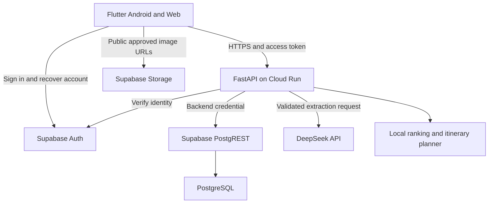
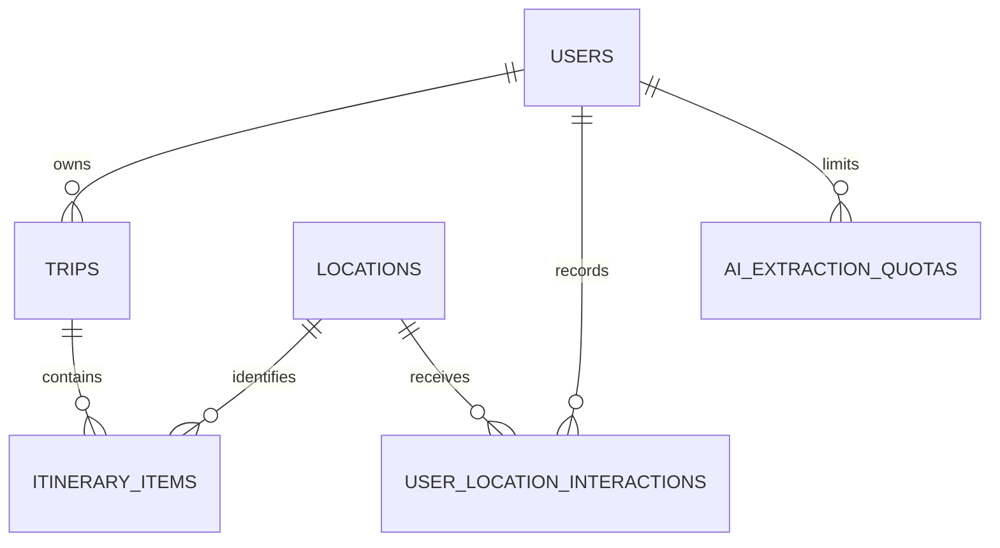

# Lagaw final project evidence

## Snapshot and verification boundaries

This index supports the [three-page final technical brief](https://docs.google.com/document/d/1BXstHsSUHi6EQG0qMVQRvVTjW1bX91M3P--fmwL290w/edit), refreshed on November 27, 2026 after the final release and deployed hardening checks. Lagaw is a Bacolod City destination discovery and trip-planning application for Android and the web. It combines a curated catalogue, persisted travel preferences and interactions, trip CRUD, backend-validated preference extraction, recommendation ranking and a constraint-aware itinerary planner.

The current source and deployed image commit is [main `b95ab17697474a58d6f5b7c7e26db0994fe35434`](https://github.com/relax-mode/lagaw/commit/b95ab17697474a58d6f5b7c7e26db0994fe35434). A read-only Cloud Run query on November 27 confirmed production revision `lagaw-api-00042-xkl`, 100% latest-revision traffic, and that full SHA in both the image tag and commit label. [CI run 46002972952](https://github.com/relax-mode/lagaw/actions/runs/46002972952) deployed staging and production successfully, including production web deployment `65bf18ed` and staging web deployment `7ed08233`.

[Release v1.0.0](https://github.com/relax-mode/lagaw/releases/tag/v1.0.0) was published on November 27 at 12:16 UTC, tagged at `bf44877e2857fa99f12fa7b7c065311ad939c5e7`. The later main commit is [PR214](https://github.com/relax-mode/lagaw/pull/214), which changes deployment traffic controls, capacity, verification tests and documentation; the application code remains equivalent to the tagged release. The tag and deployed image therefore have distinct commit identifiers. GitHub reports **60 closed issues and zero open issues**; all four sprint milestones contain zero open issues. These statements describe completed scoped work, not a claim that every planned feature from the original pitch was implemented.

November 27 public checks returned HTTP 200 for production `/health` and `/ready`, and for production and staging web pages with a normal browser user agent. The production catalogue returned **30 destinations, 30 image URLs, 30 coordinate pairs, 30 nonempty hour schedules and 29 known upper cost estimates**, using `limit=100` rather than the default ten-record page. Field presence establishes coverage, not current venue accuracy, authenticated CRUD success or itinerary feasibility. Public probes do not exercise paid AI. The [dated verification record](evidence/final-documentation-check-2026-11-27.json) separates these observations from historical test results.

## Architecture and ownership boundaries

Cloudflare Pages serves the Flutter web build; Android uses the same backend API. **All application database and AI access is backend-owned.** Direct frontend Auth calls and public image downloads are separate, intentional boundaries. The LLM has no database access. Database requests use `httpx` and PostgREST, not the installed SQLAlchemy helper path. Supabase Auth verifies token signatures; backend checks also constrain issuer, audience, role, lifetime and confirmed identity. The backend resolves profile ownership and filters each protected resource. Another owner's trip is returned as 404.

See [authentication](authentication.md), [database design](database.md), [API and health reference](backend-health-api.md), [entry point](../backend/app/main.py) and [database client](../backend/app/database.py). RLS blocks direct client table access, but the backend service role bypasses RLS: route-level ownership checks remain essential.

## Data model and persistence

The five domain tables use UUID primary keys and foreign keys. Deleting a trip cascades to its itinerary items; referenced locations are protected from deletion. Two operational tables, `ai_extraction_quotas` and the project-wide `ai_extraction_budget`, bring the total to **seven public application tables**; Supabase Auth and Storage schemas are separate. [Eight SQL migrations](../supabase/migrations/) establish schema, seed records, atomic itinerary generation, verified Auth-profile links, extraction quotas, image-storage policies, saved-itinerary integrity and the aggregate extraction budget. The two November 27 migrations were applied atomically to staging, verified, then promoted to production ([final deployment evidence](https://github.com/relax-mode/lagaw/issues/202#issuecomment-7220097235)). Hosted PostgreSQL persists application state independently of web builds and backend container replacements.

Core APIs are [trip CRUD](trips-api.md) and [mutations](trip-mutations-api.md): `POST/GET /api/v1/trips`, `GET/PATCH/DELETE /api/v1/trips/{id}`; [manual itinerary items](trip-items-api.md); [interactions](interactions-api.md); `GET/PUT /api/v1/me/preferences`; `POST /api/v1/me/recommendations`; `POST /api/v1/trips/{id}/recommendations`; `POST /api/v1/trips/{id}/generate-itinerary`; and `POST /api/v1/preferences/extract`. [Production OpenAPI](https://lagaw-api-663710289405.asia-southeast1.run.app/docs) provides exact request schemas. Validation bounds dates, decimals, strings, enumerations and pagination. Request-body middleware enforces a **64 KiB (65,536-byte)** limit and returns HTTP 413 for oversized requests. Errors distinguish invalid input, ownership, concurrent edits, unavailable dependencies and infeasible schedules.

## Capability and scope matrix

| Area | Implemented behavior | Boundary or remaining limitation |
|---|---|---|
| Catalogue | Browse, search, category filters and attributed photos | Curated Bacolod coverage; prices, hours and access can change |
| Discovery | Persist likes, passes, saves and ratings; reload history | Swipe deck is catalogue order; no un-save or undo pass |
| Preferences | Save onboarding preferences; content-only discovery from tags, group and explicit per-person/per-visit budget | Onboarding recommendations use no interaction history; passes are not excluded on this path |
| Trips | Create, retrieve, edit and permanently delete trips; manual itinerary items | Archive is outside the implemented scope |
| Extraction | Free text becomes a validated draft requiring confirmation | Extracted budget level, duration and pace are review context; numeric budget and group require supported form input |
| Trip ranking | Content baseline with optional supported-user collaborative blend; known-cost and compatibility filtering | Any historical left swipe excludes a place on this path; no automatic model retraining |
| Scheduling | Check hours, visit duration, estimated travel and cumulative cost; atomic replacement with revision checks | Greedy estimates, not optimal routing, live traffic, transit schedules or guaranteed venue access |
| Account access | Supabase sign-in, confirmation and recovery; backend ownership | Account deletion and comprehensive retention policy are not documented |
| Deferred features | No demonstrated admin catalogue UI, booking/payment workflow or trip archive | Setting/accessibility columns are absent; do not claim working accessibility filtering |

[Discovery interaction evidence](evidence/discovery-interactions.md), [onboarding discovery](evidence/onboarding-discovery.md), [trip UI evidence](evidence/trip-itinerary-ui.md), [itinerary generation](itinerary-generation-api.md), and [current extraction model](../frontend/lib/models/preference_draft.dart) support these distinctions. “Implemented” describes inspected behavior and linked evidence; it does not imply every path was freshly exercised in production on November 27.

## Technology and service disclosure

| Layer | Actual technology and purpose | Version or tier disclosure |
|---|---|---|
| Client | Flutter, Dart; Flutter Material widgets; `http`, `supabase_flutter`, `shared_preferences`, `url_launcher` | App `1.0.0+1`; Dart constraint `^3.13.5`; [manifest](../frontend/pubspec.yaml) and [lockfile](../frontend/pubspec.lock) |
| API | Python, FastAPI, Uvicorn, Pydantic, httpx, python-dotenv, PyJWT | Python `3.12-slim`; API metadata `0.1.0`; [dependency ranges](../backend/requirements.txt) and [container](../backend/Dockerfile) |
| Data and model | PostgreSQL on Supabase, PostgREST, Auth, Storage; NumPy SVD; SQLAlchemy/psycopg verification helpers | NumPy `>=2.5.4,<3`; Supabase account tier unverified |
| Hosted AI | DeepSeek through direct httpx calls | `deepseek-flash` configurable alias; immutable model revision unpinned; prepaid paid API |
| Infrastructure | Cloud Run Singapore, Cloudflare Pages, Artifact Registry, Secret Manager, workload identity | Cloudflare free-tier selection is recorded in the sprint log; current paid subscriptions and actual spend are not independently verified |
| Quality and delivery | GitHub Actions, pytest, Flutter tests/analyzer, Ruff, dependency/security checks, scheduled smoke checks, Cloud Run logs | [PIPELINE.md](../PIPELINE.md); Wrangler `4.158.0` in [package.json](../package.json); no separate analytics product established |
| Email | Brevo SMTP used by Supabase Auth | [November 5 human-observed acceptance](auth-email-brevo-verification.md); Supabase sign-up email limit of 30/hour confirmed in [#204](https://github.com/relax-mode/lagaw/issues/204); Brevo subscription tier unverified; Resend references are historical |

| Environment | Serving configuration | Cost boundary |
|---|---|---|
| Production | Cloud Run `lagaw-api`, minimum 1 / maximum 4 instances, concurrency 20; Cloudflare Pages `lagaw.pages.dev` | One warm instance retained through panel day; the plan is to return the minimum to 0 afterward. Current production therefore retains idle capacity and is not configured to scale to zero. |
| Staging | Cloud Run `lagaw-api-staging`, minimum 0 / maximum 4, concurrency 20; Pages `staging.lagaw.pages.dev` | Shared staging, not one backend per pull request |
| Database and hosted AI | Separate Supabase projects; backend-only DeepSeek extraction | Supabase purchased tier and total spend unverified; extraction attempt budgets are controls, not a billing statement |

There is no RAG pipeline, embedding service, vector database or autonomous LLM agent in this implementation. LightFM, pandas, scikit-learn, the OpenAI Python SDK and earlier hosting options should not be listed as active technologies merely because they appeared in the pitch.

## AI design and evaluation limits

[Extraction](../backend/app/deepseek.py) limits prompts to 2,000 characters and output to 512 tokens, uses JSON mode and strict schema validation, and rejects malformed or incomplete provider responses. The backend normalizes approved tags, preserves explicit overrides and reports missing fields. Extraction does not save preference or trip content; confirmed values are persisted through ordinary application actions. Quota reservations are recorded separately as described below. The code default timeout is 30 seconds; the deployment workflow configures 20 seconds. Sanitized errors offer the manual form, with no automatic paid retry.

[Quota enforcement](ai-extraction-quotas.md) reserves attempts in PostgreSQL before a provider call: defaults **5/minute and 40/UTC day per profile**, plus an aggregate project-wide ceiling of **10/day in staging and 100/day in production**, shared across backend instances. The RPC checks and increments counters transactionally. Daily windows reset at **00:00 UTC**; the minute limit resets on the next UTC minute. Provider failures consume successful reservations; rejected requests do not consume more attempts. Exhaustion returns HTTP 429 with `Retry-After` and manual fallback; unavailable quota storage or a missing budget fails closed with 503 before a provider call. These controls bound attempts, not exact monetary spend. A historical **$3/month GCP budget alert** in the [sprint log](sprint-log.md) is an alert, not a spending cap.

[Local ranking](hybrid-recommender.md) uses `content-v1` and rank-at-most-3 `signed-svd-v1`, blending 60% content and 40% collaborative when support thresholds are met. [Deployed artifacts](collaborative-model-serving.md) were trained on seeded demo accounts, independently per environment. “Real” provenance means stored events, not organic traveler validation. Unseen users and invalid/missing models fall back to content ranking; new swipes do not update the fitted artifact.

[Week 3 evaluation](week3-evaluation.md) reports **27/27 mocked extraction cases and 84/84 field checks**. [Synthetic hybrid evaluation](evidence/hybrid-results.md) uses **256 training events and 24 held-out events**, with Recall@3 **0.75 content versus 1.00 hybrid**. These establish contract behavior and recovery of a constructed signal, not live-model accuracy or traveler satisfaction. [Cold-start results](content-first-evaluation.md) cover 16 scenarios against two catalogues; the historical ten-record source results are not current 30-destination performance.

The planner uses Haversine distance multiplied by 1.3, fixed mode speeds/fares and greedy scheduling. Unknown required fields fail closed. Trips longer than 31 days and unsupported opening-hour formats are rejected. Currency estimates and feasibility remain conditional on the supplied catalogue.

## Verification and release status

The latest full [CI run 46002972952](https://github.com/relax-mode/lagaw/actions/runs/46002972952), on November 27 at `b95ab17`, passed **1,178 offline backend, 116 database integration and 303 Flutter tests: 1,597 total**. Flutter analysis found no issues. Database migration/schema checks, AI fixture evaluation, security checks, staging deployment, and production API/web deployment and smoke checks succeeded. These are dated automated results, not 1,597 production user journeys. The latest log's 303 Flutter tests supersedes the earlier 302 count in issue comments.

The [audit PR199](https://github.com/relax-mode/lagaw/pull/199) and [initial documentation PR200](https://github.com/relax-mode/lagaw/pull/200) are merged. Subsequent implementation and final evidence resolve the earlier blocking findings:

| Work | Implemented and verified outcome | Final evidence |
|---|---|---|
| Backend integrity and quota controls | A date edit that strands a visit returns 409 and preserves data; compatible edits succeed; item removal returns 204; reducing budget invalidates the stale estimate while preserving visits; cross-account trip access returns 404; shared extraction cap is installed in both environments | [PR205](https://github.com/relax-mode/lagaw/pull/205), [#202 final verification](https://github.com/relax-mode/lagaw/issues/202#issuecomment-7220097235) |
| Frontend resilience and identity isolation | First-load timeout allows backend startup; readable AI cooldown retains manual entry; switching accounts resets navigation/data and rejects prior-identity responses; uncertain create offers Open My Trips rather than encouraging duplicate retry | [PR210](https://github.com/relax-mode/lagaw/pull/210), [#203 deployed browser verification](https://github.com/relax-mode/lagaw/issues/203#issuecomment-7219461587), [Android two-account evidence](evidence/203-account-switch.md) |
| Deployment routing and capacity | CI routes 100% of traffic to the latest ready revision and verifies the expected image tag; production keeps one warm instance and allows four | [PR214](https://github.com/relax-mode/lagaw/pull/214), [#204 final verification](https://github.com/relax-mode/lagaw/issues/204#issuecomment-7220099399) |

The #204 evidence records 150 concurrent staging reads with **150 HTTP 200 responses, 0% errors, p50 4.051 seconds and p95 6.732 seconds**. This is a bounded read-only load observation, not a general throughput guarantee. The final issue comments contain owner-recorded deployed checks; the documentation refresh independently inspected those records and the current deployment metadata without rerunning authenticated workflows or paid AI calls.

[Scheduled run 46005596144](https://github.com/relax-mode/lagaw/actions/runs/46005596144) passed both live staging AI extraction and Cloudflare credential verification. The later [run 46010653151](https://github.com/relax-mode/lagaw/actions/runs/46010653151) passed Cloudflare verification but marks the AI step failed because the newly enabled staging allowance correctly returned a controlled 429: 24 prior daily reservations exceeded the limit of 10. The [final #202 record](https://github.com/relax-mode/lagaw/issues/202#issuecomment-7220097235) confirms that rejection occurred before a DeepSeek call. This is quota enforcement, not evidence of a current Cloudflare credential failure or an unlimited provider budget.

The [pipeline](../PIPELINE.md) and [sprint log](sprint-log.md) document branch/PR gates, staging before production, smoke checks, metrics and rollback procedures. The [deployment challenge recording](https://drive.google.com/file/d/1KFLflyaDlxE3RbTF7qSiaj7HCFn0bq1n/view), `Deployment_Challenge_lagaw_Relax_mode.mp4`, is present and panel-readable through its link. File metadata and sharing were verified; this review did not watch the entire recording or independently establish uninterrupted execution. The [team materials folder](https://drive.google.com/drive/folders/1iX_TqWex11pZz6is73KHjOHGaeRbnth2) contains related presentation materials. A direct sprint-board URL was not independently verified because the available repository token lacks Projects read permission; the linked sprint log and closed issues provide the evidence actually inspected.

## Ownership and external work

The team names and roles in the user-maintained final document are **Kyle Yuan Uy / CyGray, sole DevOps Engineer; Andrew Eroyla / aranxshx, Backend/API Engineer; Roel Jr. Lumauag / roellumauagjr, Frontend Engineer; and Jefferson Magoliman / s2302663-del, AI/ML Engineer**. These full names supersede the abbreviated names in [README](../README.md#team). PRs and issue assignments support component ownership; declarations do not imply every line was independently written by its owner.

Claude assistance is explicitly recorded for UI design, implementation, image work and device verification. Audit PR 199 identifies GPT 6.2 Astra High and Gemini 4 Neon Extra High review work; ChatGPT/Codex assisted this documentation. A complete inventory of all major coding assistants, paid tiers and substantial generated contributions still requires team attestation. Review and tests remain the team's responsibility.

[Image provenance](destination-image-manifest.json) distinguishes Wikimedia Commons CC BY/CC BY-SA images, Roel's photographer permissions, and supplied images authorized for project use by the project owner. Project-use authorization is not independent proof of underlying copyright ownership. [Outfit](../frontend/assets/fonts/OFL.txt) uses SIL OFL 1.1. Destination source research and synthetic evaluation fixtures are linked above; do not describe synthetic interactions as real traveler data. Broader asset/template provenance and copying disclosures require owner confirmation where records are absent.
