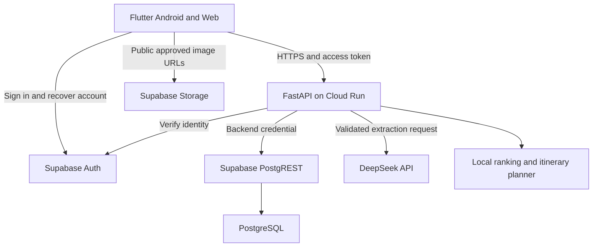
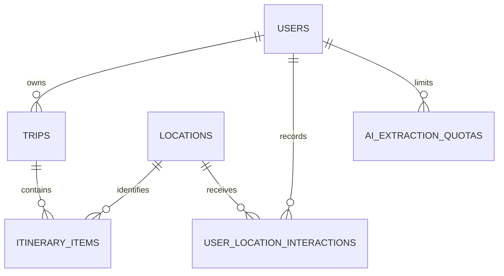

# Lagaw final project evidence

## Snapshot and verification boundaries

This index supports the three-page final technical brief. Lagaw is a Bacolod City destination discovery and trip-planning application for Android and the web. It combines a curated catalogue, persisted travel preferences and interactions, trip CRUD, backend-validated preference extraction, recommendation ranking and a constraint-aware itinerary planner.

The source snapshot is [main `f4076c61c81885ef94cb55051634a43189bb6bc2`](https://github.com/relax-mode/lagaw/commit/f4076c61c81885ef94cb55051634a43189bb6bc2). On November 27, 2026, production Cloud Run served revision `lagaw-api-00040-bpl` at 100% traffic, built from `26cde8536b829e46f304fe031fd5e7c63860f63b`. Runtime application and migration files have no difference between those commits; tests and catalogue data differ. The last successful web deployment evidence is [November 15 CI run 43727841016](https://github.com/relax-mode/lagaw/actions/runs/43727841016), at `f4076c6`; current Cloudflare deployment metadata was not independently reverified. No final Git tag or GitHub release was present at this review.

November 27 public checks returned HTTP 200 for production `/health` and `/ready`, and for production and staging web pages with a normal browser user agent. The production catalogue returned **30 destinations, 30 image URLs, 30 coordinate pairs, 30 nonempty hour schedules and 29 known upper cost estimates**, using `limit=100` rather than the default ten-record page. Field presence establishes coverage, not current venue accuracy, authenticated CRUD success or itinerary feasibility. Public probes do not exercise paid AI. The [dated verification record](evidence/final-documentation-check-2026-11-27.json) separates these observations from historical test results.

## Architecture and ownership boundaries

Cloudflare Pages serves the Flutter web build; Android uses the same backend API. **All application database and AI access is backend-owned.** Direct frontend Auth calls and public image downloads are separate, intentional boundaries. The LLM has no database access. Database requests use `httpx` and PostgREST, not the installed SQLAlchemy helper path. Supabase Auth verifies token signatures; backend checks also constrain issuer, audience, role, lifetime and confirmed identity. The backend resolves profile ownership and filters each protected resource. Another owner's trip is returned as 404.

See [authentication](authentication.md), [database design](database.md), [API and health reference](backend-health-api.md), [entry point](../backend/app/main.py) and [database client](../backend/app/database.py). RLS blocks direct client table access, but the backend service role bypasses RLS: route-level ownership checks remain essential.

## Data model and persistence

The five domain tables use UUID primary keys and foreign keys. Deleting a trip cascades to its itinerary items; referenced locations are protected from deletion. `ai_extraction_quotas` is an additional operational table. [Six SQL migrations](../supabase/migrations/) establish schema, seed records, atomic itinerary generation, verified Auth-profile links, extraction quotas and image-storage policies. Hosted PostgreSQL persists application state independently of web builds and backend container replacements.

Core APIs are [trip CRUD](trips-api.md) and [mutations](trip-mutations-api.md): `POST/GET /api/v1/trips`, `GET/PATCH/DELETE /api/v1/trips/{id}`; [manual itinerary items](trip-items-api.md); [interactions](interactions-api.md); `GET/PUT /api/v1/me/preferences`; `POST /api/v1/me/recommendations`; `POST /api/v1/trips/{id}/recommendations`; `POST /api/v1/trips/{id}/generate-itinerary`; and `POST /api/v1/preferences/extract`. [Production OpenAPI](https://lagaw-api-i5kvldluga-as.a.run.app/docs) provides exact request schemas. Validation bounds dates, decimals, strings, enumerations and pagination. Errors distinguish invalid input, ownership, concurrent edits, unavailable dependencies and infeasible schedules.

## Capability and scope matrix

| Area | Implemented behavior | Boundary or remaining limitation |
|---|---|---|
| Catalogue | Browse, search, category filters and attributed photos | Curated Bacolod coverage; prices, hours and access can change |
| Discovery | Persist likes, passes, saves and ratings; reload history | Swipe deck is catalogue order; no un-save or undo pass |
| Preferences | Save onboarding preferences; content-only discovery from tags, group and explicit per-person/per-visit budget | Onboarding recommendations use no interaction history; passes are not excluded on this path |
| Trips | Create, retrieve, edit and permanently delete trips; manual itinerary items | Archive is not implemented despite older README wording |
| Extraction | Free text becomes a validated draft requiring confirmation | Extracted budget level, duration and pace are review context; numeric budget and group require supported form input |
| Trip ranking | Content baseline with optional supported-user collaborative blend; known-cost and compatibility filtering | Any historical left swipe excludes a place on this path; no automatic model retraining |
| Scheduling | Check hours, visit duration, estimated travel and cumulative cost; atomic replacement with revision checks | Greedy estimates, not optimal routing, live traffic, transit schedules or guaranteed venue access |
| Account access | Supabase sign-in, confirmation and recovery; backend ownership | Account deletion and comprehensive retention policy are not documented |
| Deferred features | No demonstrated admin catalogue UI, booking/payment workflow or trip archive | Setting/accessibility columns are absent; do not claim working accessibility filtering |

[Discovery interaction evidence](evidence/discovery-interactions.md), [onboarding discovery](evidence/onboarding-discovery.md), [trip UI evidence](evidence/trip-itinerary-ui.md), [itinerary generation](itinerary-generation-api.md), and [current extraction model](../frontend/lib/models/preference_draft.dart) support these distinctions. “Implemented” describes inspected behavior and linked evidence; it does not imply every path was freshly exercised in production on November 27.

## Technology and service disclosure

| Layer | Actual technology and purpose | Version or tier disclosure |
|---|---|---|
| Client | Flutter, Dart; Flutter Material widgets; `http`, `supabase_flutter`, `shared_preferences`, `url_launcher` | App `1.0.0+1`; Dart constraint `^3.13.5`; [manifest](../frontend/pubspec.yaml) and [lockfile](../frontend/pubspec.lock) |
| API | Python, FastAPI, Uvicorn, Pydantic, httpx, python-dotenv, PyJWT | Python `3.12-slim`; API metadata `0.1.0`; [dependency ranges](../backend/requirements.txt) and [container](../backend/Dockerfile) |
| Data and model | PostgreSQL on Supabase, PostgREST, Auth, Storage; NumPy SVD; SQLAlchemy/psycopg verification helpers | NumPy `>=2.5.4,<3`; Supabase account tier unverified |
| Hosted AI | DeepSeek through direct httpx calls | `deepseek-flash` configurable alias; immutable model revision unpinned; prepaid paid API |
| Infrastructure | Cloud Run Singapore, Cloudflare Pages, Artifact Registry, Secret Manager, workload identity | Actual current paid/free account plans and spend require owner attestation |
| Quality and delivery | GitHub Actions, pytest, Flutter tests/analyzer, Ruff, dependency/security checks, scheduled smoke checks, Cloud Run logs | [PIPELINE.md](../PIPELINE.md); Wrangler `4.158.0` in [package.json](../package.json); no separate analytics product established |
| Email | Brevo SMTP used by Supabase Auth | [November 5 human-observed acceptance](auth-email-brevo-verification.md); active plan and quota unverified; Resend references are historical |

There is no RAG pipeline, embedding service, vector database or autonomous LLM agent in this implementation. LightFM, pandas, scikit-learn, the OpenAI Python SDK and earlier hosting options should not be listed as active technologies merely because they appeared in the pitch.

## AI design and evaluation limits

[Extraction](../backend/app/deepseek.py) limits prompts to 2,000 characters and output to 512 tokens, uses JSON mode and strict schema validation, and rejects malformed or incomplete provider responses. The backend normalizes approved tags, preserves explicit overrides and reports missing fields. It stores nothing until the user confirms through ordinary application actions. The code default timeout is 30 seconds; the deployment workflow configures 20 seconds. Sanitized errors offer the manual form, with no automatic paid retry.

[Quota enforcement](ai-extraction-quotas.md) reserves attempts in PostgreSQL before a provider call: defaults **5/minute and 40/UTC day per profile**, shared across backend instances. Failures consume reservations; unavailable quota storage fails closed. These are per-user attempt limits, not a global monetary ceiling. A historical **$3/month GCP budget alert** in the [sprint log](sprint-log.md) is an alert, not a spending cap.

[Local ranking](hybrid-recommender.md) uses `content-v1` and rank-at-most-3 `signed-svd-v1`, blending 60% content and 40% collaborative when support thresholds are met. [Deployed artifacts](collaborative-model-serving.md) were trained on seeded demo accounts, independently per environment. “Real” provenance means stored events, not organic traveler validation. Unseen users and invalid/missing models fall back to content ranking; new swipes do not update the fitted artifact.

[Week 3 evaluation](week3-evaluation.md) reports **27/27 mocked extraction cases and 84/84 field checks**. [Synthetic hybrid evaluation](evidence/hybrid-results.md) uses **256 training events and 24 held-out events**, with Recall@3 **0.75 content versus 1.00 hybrid**. These establish contract behavior and recovery of a constructed signal, not live-model accuracy or traveler satisfaction. [Cold-start results](content-first-evaluation.md) cover 16 scenarios against two catalogues; the historical ten-record source results are not current 30-destination performance.

The planner uses Haversine distance multiplied by 1.3, fixed mode speeds/fares and greedy scheduling. Unknown required fields fail closed. Trips longer than 31 days and unsupported opening-hour formats are rejected. Currency estimates and feasibility remain conditional on the supplied catalogue.

## Verification and release status

The [November 15 CI run](https://github.com/relax-mode/lagaw/actions/runs/43727841016) at the documented source SHA reports **1,136 backend, 108 database and 289 Flutter tests passed, with zero failures**. These are dated automated results, not 1,533 fresh production tests. [November 26 run 45790667724](https://github.com/relax-mode/lagaw/actions/runs/45790667724) passed staging AI checks but failed Cloudflare preflight; the failure cause was not established. The public [audit PR 199](https://github.com/relax-mode/lagaw/pull/199) is unmerged and documents unresolved review findings, including account-state isolation, uncertain-write recovery, date/cost integrity, quota feedback and recommendation labeling.

The [pipeline](../PIPELINE.md) and [sprint log](sprint-log.md) document branch/PR gates, staging before production, smoke checks, metrics and rollback procedures. The final release tag and uninterrupted deployment-challenge recording remain missing evidence. A sprint-board URL was not verified: the available repository token could not read Projects, and the Issues backlog is not a substitute for a board with sprint history. Resolve these and the failed Cloudflare deployment credential preflight before describing the project as release-complete.

## Ownership and external work

[Declared roles](../README.md#team) name **Kyle / CyGray as the sole DevOps Engineer**, Andrew / aranxshx for backend/API, Roel / roellumauagjr for Flutter, and Jayperson / s2302663-del for AI. PRs and issue assignments support component ownership; declarations do not imply every line was independently written by its owner.

Claude assistance is explicitly recorded for UI design, implementation, image work and device verification. Audit PR 199 identifies GPT 6.2 Astra High and Gemini 4 Neon Extra High review work; ChatGPT/Codex assisted this documentation. A complete inventory of all major coding assistants, paid tiers and substantial generated contributions still requires team attestation. Review and tests remain the team's responsibility.

[Image provenance](destination-image-manifest.json) distinguishes Wikimedia Commons CC BY/CC BY-SA images, Roel's photographer permissions, and supplied images authorized for project use by the project owner. Project-use authorization is not independent proof of underlying copyright ownership. [Outfit](../frontend/assets/fonts/OFL.txt) uses SIL OFL 1.1. Destination source research and synthetic evaluation fixtures are linked above; do not describe synthetic interactions as real traveler data. Broader asset/template provenance and copying disclosures require owner confirmation where records are absent.
